# MAVRIC

**Multimodal Audio-Video-RFID Interaction and Control.** A behavioural suite: synchronized video, audio and RFID
identification of individual subjects, with event-driven outputs for task control and interaction.

Version 0.9.0 · MIT licence · Windows 10/11 · Python 3.12

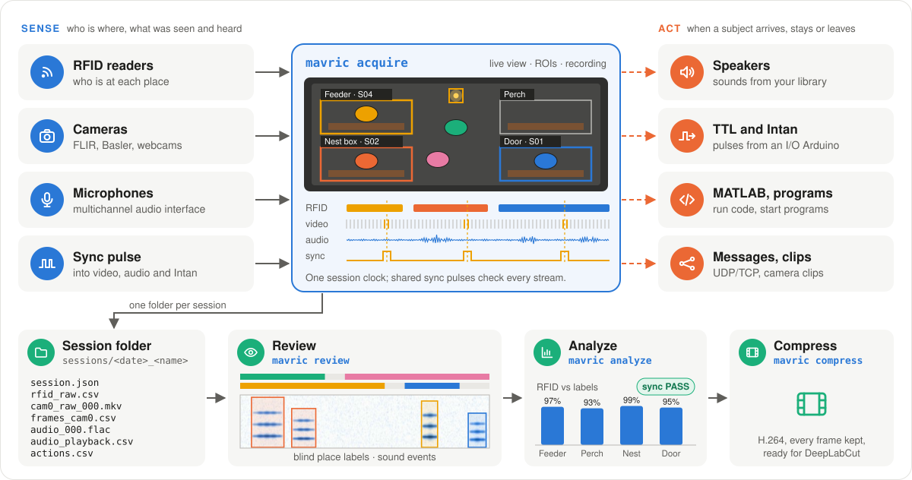

MAVRIC follows RFID-tagged subjects at one or more **places**: wherever an RFID reader sees tags, such as a perch,
a feeder, a nest box or a doorway.

- **Sense:** RFID readers tell who is at each place. Cameras and microphones record what happens, all on one clock.
- **Check the timing:** one random sync pulse goes into every stream (an LED in view of the cameras, an audio input,
  Intan). The analysis matches the pulses and reports **PASS** or FAIL.
- **Act:** when a chosen subject arrives at, stays at or leaves a place, MAVRIC can play a sound, send a TTL pulse,
  start an Intan recording, run MATLAB code or a program, send a network message, or record a camera clip.
- **Review:** label who is where, blind to RFID, then curate RFID against the video. Label sound events with emitter
  suggestions. Sessions without video can be reviewed for audio alone.
- **Analyze:** RFID accuracy against your labels, bouts, time budgets and plots.
- **Share:** compressed copies of the video, ready for DeepLabCut.

**Contents**
1. [Getting started](#getting-started)
2. [Acquire](#1-acquire)
3. [Sounds, outputs and camera clips](#2-sounds-outputs-and-camera-clips)
4. [Review](#3-review)
5. [Analyze](#4-analyze)
6. [Compress video and DeepLabCut](#5-compress-video-and-deeplabcut)
7. [Commands](#commands)
8. [Files](#files)
9. [Troubleshooting](#troubleshooting)
10. [Hardware](#hardware)
11. [Documentation](#documentation)
12. [Licence and citation](#licence-and-citation)

---

## Getting started

### Install

**Requirements**
- Windows 10/11, 64-bit. Review and analysis should also work on Linux and macOS, but are untested.
- [Miniforge](https://conda-forge.org/download/) or Miniconda, and Git.
- For acquisition: USB 3 ports for the cameras, and disk space for raw video (about 50 GB per camera-hour at
  1280×1024, 30 fps).

**New PC?** [docs/installation.md](docs/installation.md) walks through everything from a clean Windows: Windows
settings, Git and conda, the drivers and vendor software (Arduino, Spinnaker, pylon, MOTU, Intan, MATLAB), MAVRIC,
the firmware and the first checks.

**Short version.** In the conda prompt (*Miniforge Prompt* or *Anaconda Prompt*):

```bash
git clone https://github.com/JesusJBallesteros/MAVRIC.git
cd MAVRIC
conda env create -f environment.yml
conda activate mavric
pip install --no-deps -e .
mavric selftest
```

`mavric selftest` runs the tests (about 2 minutes). From then on, `conda activate mavric` gives you the `mavric`
command. To update: `git pull`, then `conda env update -f environment.yml --prune`.

### Try it without hardware

Every device has a simulated twin: five tagged subjects moving between four places, cameras, an RFID Arduino,
microphones, speakers and the sync pulse.

```bash
mavric acquire --sim                         # live window with the simulated cage
mavric simulate sessions --audio             # write a complete simulated session (with ground truth)
mavric review sessions/<that session>        # label it
mavric analyze sessions/<that session>       # sync check and RFID vs labels
```

`mavric simulate sessions --playback 20 --sound-labels` also plays a sound about every 20 s, which perched subjects
sometimes answer, and writes the true calls as labeled sound events, so the sound analysis has something to show.

### Set up your rig

**[docs/quickstart.md](docs/quickstart.md)** takes you from an installed MAVRIC to a first analyzed session: the
project folder, every configuration file, each device's setup and check, recording, and what each file in a
session folder contains. In short:

1. **Configure** `config/rig.yaml` (places, cameras, audio) and `config/tags.csv` (tag → subject). The first
   `mavric` command creates both from `config/examples/`.
2. **Flash** the RFID Arduino and **check each device** on its own (`mavric link-test`, `camtest`, `audio test`).
3. **Acquire:** connect, draw the place ROIs and the sync LED box once, record.
4. **Afterwards:** review, analyze, compress.

---

## 1. Acquire

```bash
mavric acquire
```

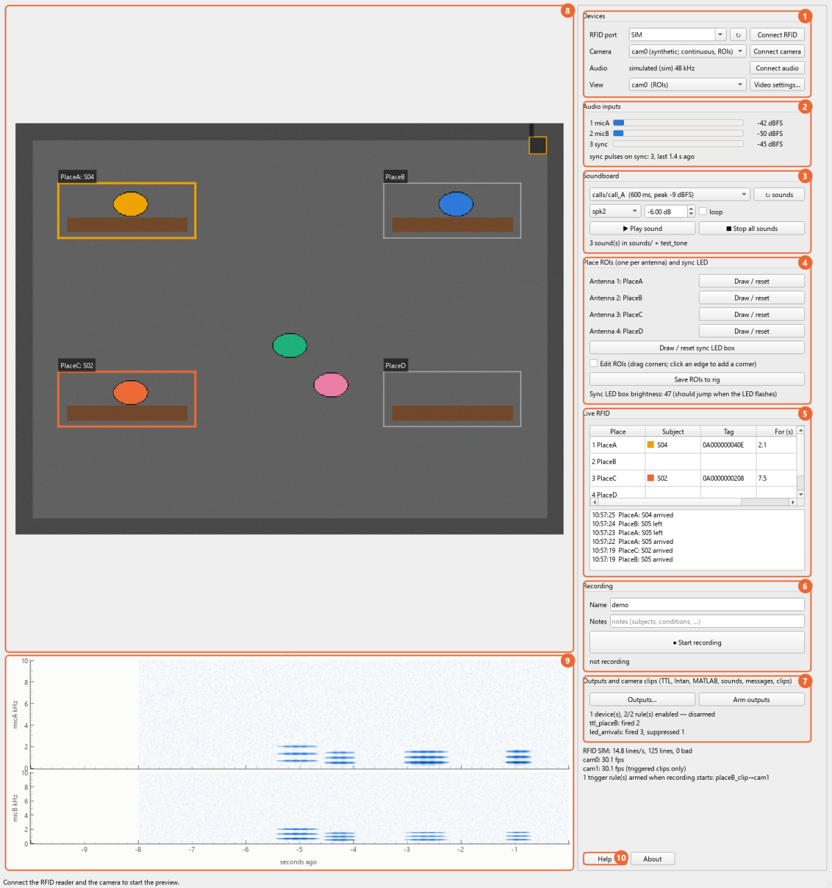

| | Control | What to do |
|---|---|---|
| 1 | **Devices** | Pick the RFID port and *Connect RFID*. Pick each camera and *Connect camera*. *Connect audio* if used. *View* picks the camera shown. *Video settings…* sets exposure, gain, size and recording format. *Calibrate cameras…* calibrates each camera's lens ([below](#calibrate-the-cameras)). |
| 2 | **Audio inputs** | Level per input, with a red CLIP warning, and a counter of the sync pulses received. |
| 3 | **Soundboard** | With speakers configured: play any sound from the library on any speaker, by hand ([§2](#2-sounds-outputs-and-camera-clips)). |
| 4 | **Place ROIs** | Once per setup, on the first camera: *Draw / reset* one ROI per antenna, then the sync LED box, then *Save ROIs to rig*. |
| 5 | **Live RFID** | The tag at each place and for how long; arrivals and departures below. |
| 6 | **Recording** | Name and notes, then *Start recording*. Everything goes to `sessions/<date>_<name>/`. |
| 7 | **Outputs** | *Outputs…* holds devices, rules and camera clips. Nothing fires until *Arm outputs*. |
| 8 | **Live view** | A place ROI takes the subject's colour while its antenna reads the tag. |
| 9 | **Spectrograms** | The last 10 s of each microphone. |
| 10 | **Help / About** | The basics, this manual, the version and the licence. |

Every control explains itself when you hover over it.

**Before a real recording, check that:**
- each ROI lights up when you hold a tag at its antenna;
- the sync LED box brightness jumps every 2–6 s;
- the audio meters move and the sync pulses are counted (if audio is used);
- the status line at the bottom shows no warnings.

**All cameras at once.** Set *View → All cameras* to see each camera with its frame rate and recording state. A
clip in progress shows as ● CLIP. Once the places are placed in 3D ([Calibrate the cameras](#calibrate-the-cameras),
step 5), every camera shows the places it sees, coloured by who is there, here and in its own live view.

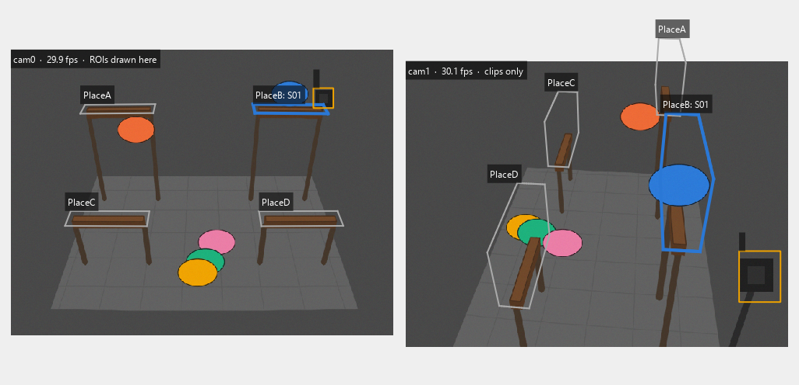

**Video settings.**
- **Camera settings (1):** exposure, gain, brightness, gamma and (colour cameras) white balance change live (⚡).
  Frame rate, image size and pixel format reconnect the camera (2).
- **Recording format (3):** *raw* is the default. Every frame is kept bit-exact (lossless FFV1), in files of about
  2 GB. *H.264* records compressed straight away (about 1 GB/h, lossy).
- **Compression defaults (4):** used by `mavric compress` and the *Compress…* buttons.

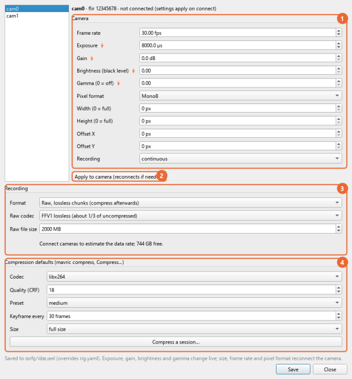

**Recording without the window** (e.g. scheduled): `mavric acquire --headless --duration 3600 --name night01`.
Add `--audio` and `--arm-outputs` as needed.

### Calibrate the cameras

Calibration measures each camera's lens (focal length, image centre, distortion) and then where every camera is,
in one shared frame in millimetres. Then each place gets its height, so every camera shows the places, and it is the
basis for 3D tracking later. It needs a **ChArUco board**: a checkerboard with an ArUco marker in every white square, so every corner can
be identified even when part of the board is hidden.

1. **The board.** Set its size in `config/rig.yaml` under `calibration: board:` (the default is 8 × 10 squares of
   39 mm). To turn a plain checkerboard into one, print stickers with `mavric calibrate sheet` (or *Sticker sheet…*
   in the dialog): a PDF at exact size with a map of which sticker goes into which white square. Measure the
   squares with calipers and enter the size.
2. **Calibrate cameras…** in the acquire window, one camera at a time. Hold the board still in front of the camera,
   in a different place and at a different angle each time. A view is captured when the board has been still for a
   moment in a new position.
   - **Fill the image:** the cells turn green as corners reach them. Use near and far, and tilt the board 20–40°.
   - **A red marker** is a sticker in the wrong square or turned. Fix it before going on.
3. **Calibrate.** **PASS** needs at most 0.5 px of error, at least 12 views, 60 % of the image covered and 4 tilted
   views. *Show straightened image* removes the lens distortion, so straight edges should look straight. Then
   *Save*. The result goes to `config/calibration.yaml`.

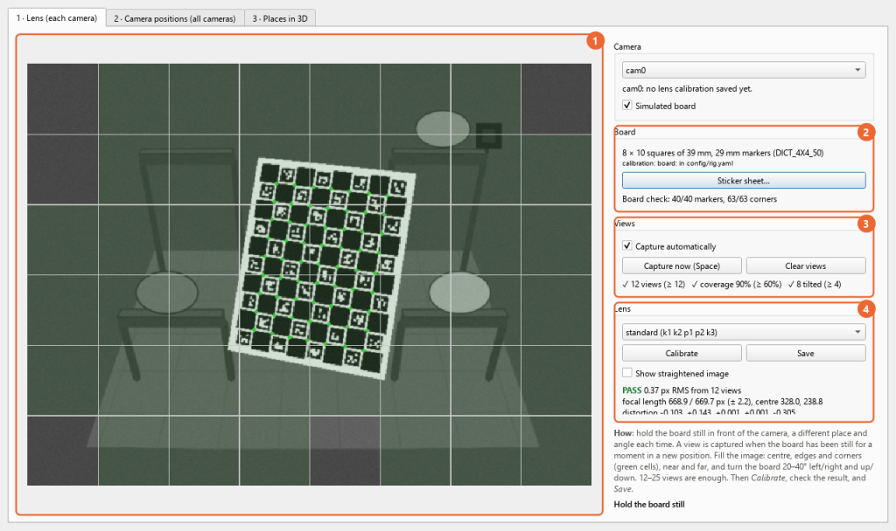

4. **Camera positions** (tab 2, once every lens is calibrated). Hold the board still where two or more cameras see
   it, in many places and angles. A snapshot is captured when the board has been still in every camera that sees
   it.
   - **Pairs:** the counts show which cameras share snapshots. Every camera must share at least 5 with another one.
     A camera that never sees the board together with the first camera can join through another camera.
   - **The origin:** lay the board flat on the floor where a camera sees it and press *Board on the floor (origin)*.
     Its top-left outer corner becomes (0, 0, 0): x along its columns, y towards its top edge, z up, in mm. Without
     an origin, positions are in the first camera's own frame.
   - ***Compute positions*:** shows where each camera is, from above and from the side. **PASS** needs each camera
     to agree with the others within 1.5 px and corners measured in 3D to be within 2 mm of the board's true shape.
     Then *Save positions*.

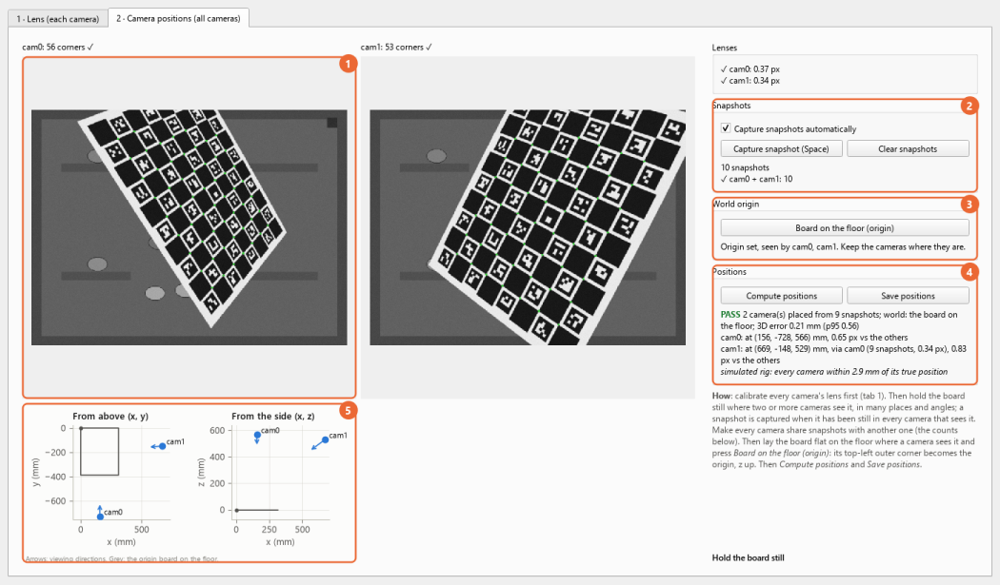

5. **Places in 3D** (tab 3, once the positions are saved with a floor origin). Each place is the outline drawn in the
   ROI camera, lifted to its height above the floor. Draw it around what the subjects stand on (the perch top, the
   platform), not around the bird.
   - **Height:** type a measured height in mm, or *Mark in two cameras*: click a spot of the place's surface in the
     ROI camera, then the same spot in another camera, on the dashed line. The sync LED needs the second click only.
   - **Box:** a box height (e.g. 130 mm) makes the place the space above its surface, so in another camera it also
     covers a subject standing on it.
   - **Check:** the outlines must sit on the places in every camera. Then *Save places*: every camera's live view,
     the *All cameras* view, review (`--camera`) and the rendered video (`--camera`) show them, and each camera
     records the sync LED's brightness.

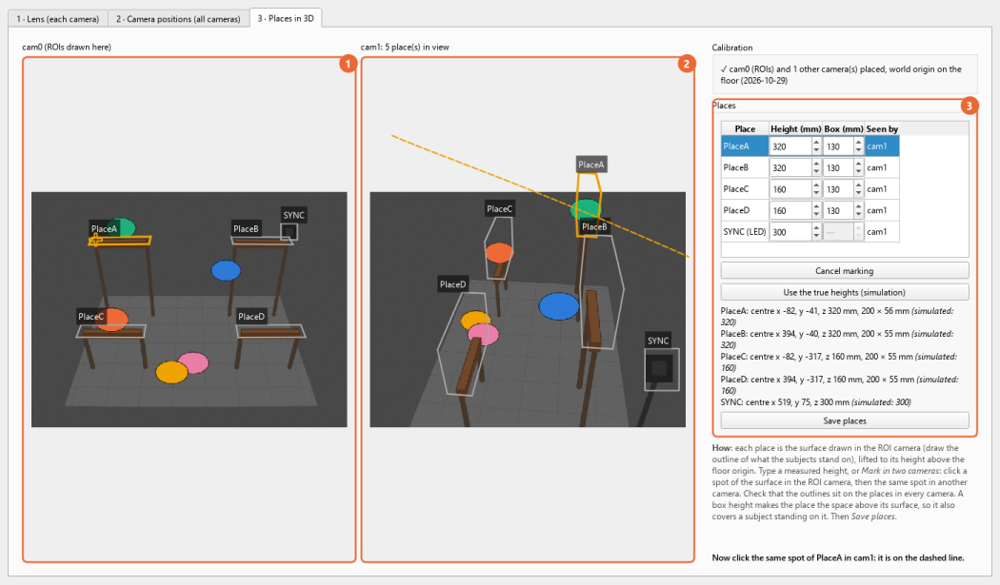

6. **Microphones and speakers** (tab 4). They need not be in any camera's view. The tab shows the space from above
   and from the side, around what the cameras see: the floor origin, the places, the cameras.
   - **Position:** drag each device to where it is, or type its position in mm from the floor origin; aim the
     microphones (the NT5 is a cardioid). *Suggested layout* starts with speakers at the corners and the two
     microphones above the long midline.
   - **Check with sound** (audio connected): *Play and measure* plays a short sweep on each speaker in turn. The
     arrival time at each microphone gives each distance (one sample at 48 kHz is 7 mm of air). The check says how
     far the typed layout is off, and which device. *Fit positions* moves the microphones (or speakers) to agree
     with the sounds, each held near its typed position. Four speakers at one height fix a microphone's x and y
     well, its height less so. The same sweeps give each microphone's recording gain and each speaker's output.
   - **Places as the microphones hear them:** for a call from each place, how much later and quieter it reaches one
     microphone than the other. Places that sound alike are flagged. Review grades the emitter suggestions by these.
   - **Speaker level at each place:** each speaker's level at the places, from the distance and its measured output.
     Then *Save devices*.

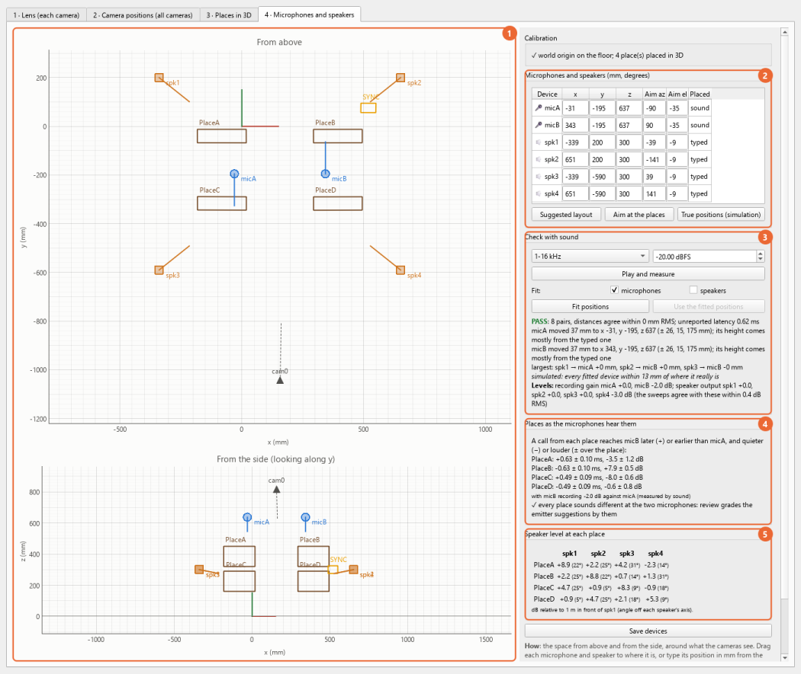

A calibration holds while the lens, focus, zoom and image size stay the same. After changing the image size in
*Video settings…*, calibrate again (the dialog warns). The simulated camera (`mavric acquire --sim`) shows a
simulated board, so you can try all of this without hardware.

## 2. Sounds, outputs and camera clips

**The sound library.** Put stimuli in the `sounds/` folder of the project (WAV, FLAC or OGG; 48 kHz mono is best,
other files are converted when loaded). Subfolders are fine: `sounds/calls/coo_A.wav` is called `calls/coo_A`.
`test_tone` (1 kHz, 200 ms) is built in.

```bash
mavric audio sounds                                    # list the library: length, peak level
mavric audio play test_tone --speaker spk1 --gain-db -10
```

**Playing sounds**
- **By hand:** the **Soundboard** in Acquire (sound, speaker or *all*, gain, loop). *■ Stop all sounds* fades
  everything out; disarming the outputs does too.
- **From rules:** add an *Audio speakers* device in **Outputs…**, then rules with `play`, `stop` or `hold_play`
  (loop while the subject is present).
- **Level safety:** the mix is clipped at `audio.max_level_dbfs` (−6 dBFS by default). MAVRIC says *LIMITED* when a
  sound plus its gain would exceed it.
- **Logged to the sample:** `audio_playback.csv` records each sound at the recording sample where it reached the
  speaker output. Review shows it as a sound event from *system:&lt;speaker&gt;*, and `session.json` keeps a
  checksum of every sound file.

**Output rules.** When RFID sees a matching subject, a device acts.
- **Devices:** I/O Arduino (TTL pins), Intan RHX, MATLAB, a program, a UDP/TCP message, speakers.
- **Events:** on arrival, on departure, or for as long as the subject is present.
- **Limits:** refractory time, delay, maximum firings per minute.
- **Safety:** nothing fires until *Arm outputs*. Disarming releases every held output. Every decision goes to the
  session's `actions.csv`, armed or not.

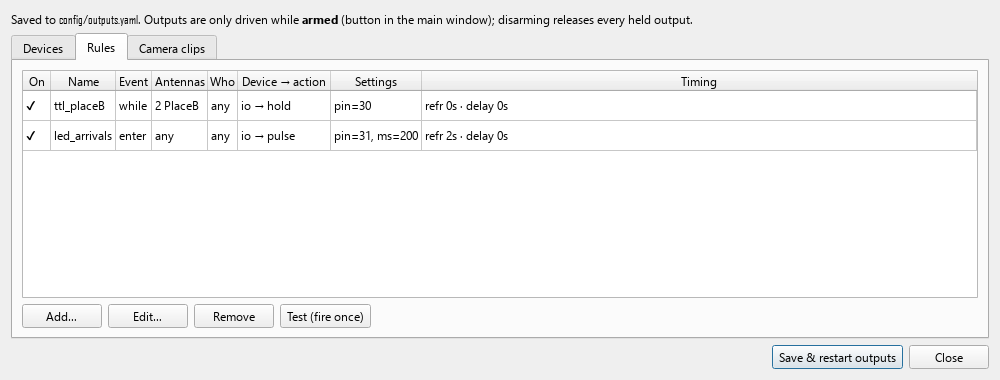

**Camera clips.** Record video on a camera while a matching subject is present, including a few seconds before the
first read. A camera set to `record: triggered` records nothing but clips.

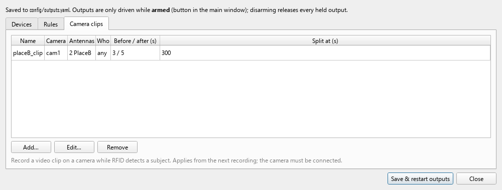

## 3. Review

```bash
mavric review sessions/<session>
```

A start dialog asks for your initials and what to review:
- **Video:** place labels and RFID curation;
- **Audio:** sound events.

Whatever the session lacks is greyed out. `--annotator <initials>` skips the dialog, and `--only video` or
`--only audio` limits the review to one.

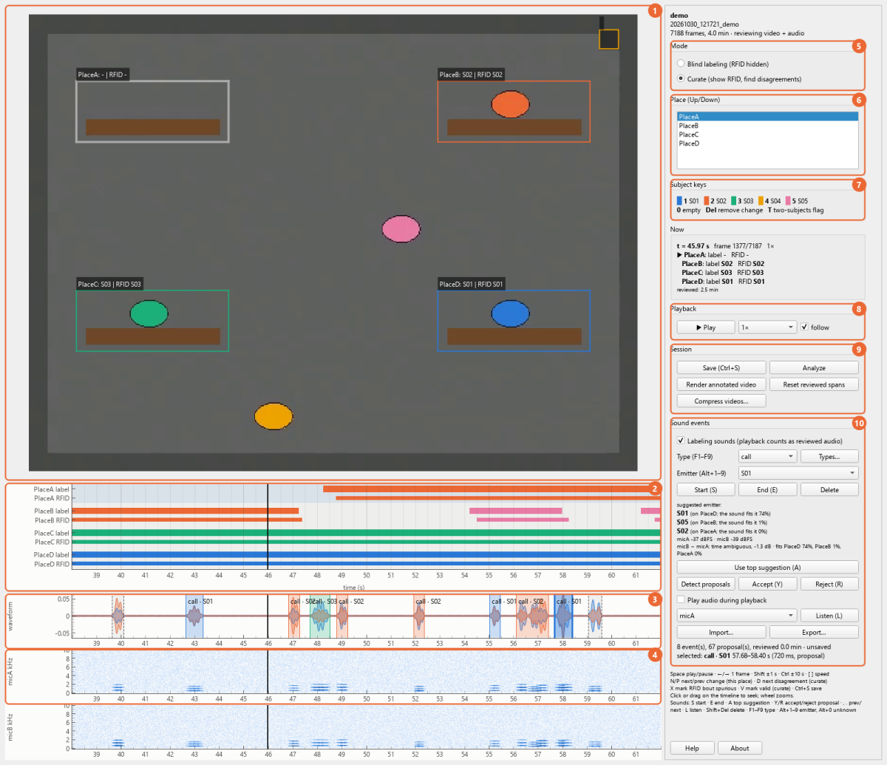

| | Part | Use |
|---|---|---|
| 1 | **Video** | The frame at the playhead. ROIs show the labeled subject (and RFID in curate mode). |
| 2 | **Timeline** | Label lanes, plus RFID lanes in curate mode. Click to seek, wheel to zoom. Grey = time you reviewed. |
| 3 | **Waveform** | Both microphones with the sound events, coloured by emitter. Dashed = automatic proposals. |
| 4 | **Spectrograms** | One per microphone, when the view spans 60 s or less. |
| 5 | **Mode** | *Blind* hides RFID while you label. *Curate* shows it and finds disagreements. |
| 6 | **Place** | The place your number keys label. |
| 7 | **Subject keys** | Which number is which subject (the order of `tags.csv`). |
| 8 | **Playback** | Play, speed, follow. |
| 9 | **Session** | Save, Analyze, Render annotated video, Compress videos. |
| 10 | **Sound events** | Type, emitter with suggestions, proposals, listening, import/export. |

**Keys**

| Place labels | | Sound events | |
|---|---|---|---|
| ↑ ↓ | choose the place | S / E | start / end an event |
| 1–9, 0 | this subject is at the place from now / empty | F1–F9 | event type |
| Del | remove the change point | Alt+1–9, Alt+0 | emitter: subject / unknown |
| Space | play / pause | A | use the suggested emitter |
| ← → | 1 frame (Shift 1 s, Ctrl 10 s) | Y / R | accept / reject a proposal |
| [ ] | slower / faster | , . | previous / next event |
| N P | next / previous change | L | listen |
| D | next disagreement (curate) | Shift+Del | delete the event |
| X / V | RFID bout spurious / valid (curate) | Ctrl+S | save (also every minute) |

**How labels count**
- **Ground truth:** only time you actually watched counts. Label blind first, then curate.
- **Emitter suggestions** combine how the two microphones heard the sound with the subjects RFID detected at each
  place at that moment.
  - **By place** (microphones and places placed in 3D, *Calibrate cameras…*): each subject is graded by how well
    the sound's arrival-time and level difference fit its place. *unknown* comes first when the sound fits a place
    where no tag was read.
  - **By side** (otherwise): set `audio.mic_near` in `rig.yaml` (which antennas each microphone is next to) to rank
    them by the louder microphone.
- **Played sounds** (soundboard, rules) appear by themselves as *playback* events.

**Audio only** (a session without cameras, or *Video* unticked): the playhead runs on its own clock (← → step
10 ms), the RFID lanes show as context, *Play audio during playback* is on, and Save writes only the sound events.
Place labels from an earlier video review are left as they are.

**Other tools:** `mavric sounds export|import` exchanges sound labels with Audacity and Raven, and
`mavric import-boris` uses BORIS labels as ground truth ([reference](docs/reference.md#2-label-mavric-review-session)).

## 4. Analyze

```bash
mavric analyze sessions/<session>
```

The report covers:
- the clock fits;
- the sync check (**PASS**/FAIL): the sync LED seen by the camera, and the pulses recorded on the audio input,
  matched against the RFID log;
- RFID accuracy against your labels (sensitivity, precision, identity, κ);
- bout timing, time budgets, output firings;
- **sounds**, once you have labeled sound events:
  - where each emitter was during each sound, by RFID and by your place labels;
  - sounds per minute for each subject at each place, counting only the time you reviewed for sounds;
  - **answers to played sounds:** sounds before and after each one, the first answer and its latency, and who
    answered. `--window 10` sets how long after a played sound an answer counts.

Tables and plots go to `analysis/` in the session folder. `--curated` leaves out the RFID bouts you marked spurious.

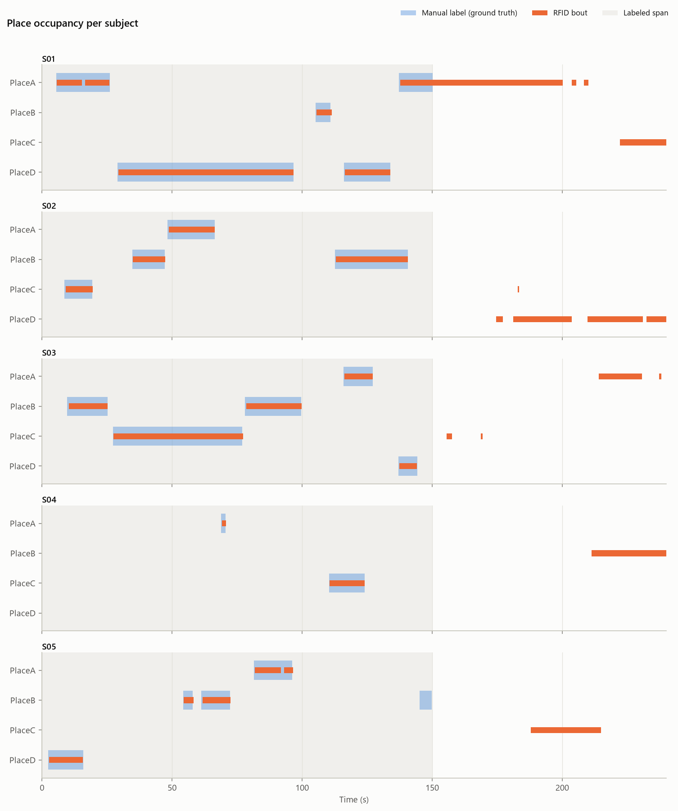
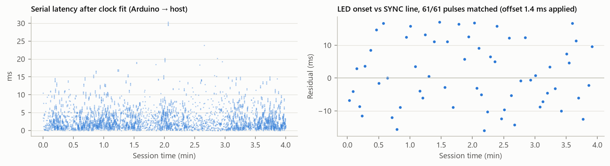
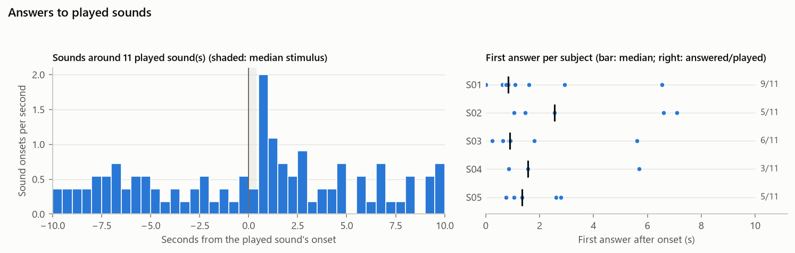

**Annotated video:** `mavric render sessions/<session>` (or *Render annotated video* in review) draws the ROIs, RFID
and your labels on the video. With audio it adds the sound (the two microphones as stereo) and a scrolling
spectrogram strip with the sound events. The sound follows each frame's true time, so it stays in step with the
picture.

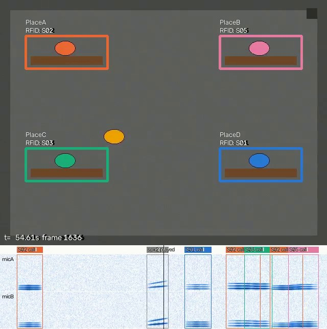

**Other tools:** `mavric timeline sessions/<session>` writes the audio on the video's clock, Audacity label tracks
(sounds, played sounds, places per subject) and `timeline.csv`. Audacity, Ethograph and BORIS can then show video,
sound and labels together.

## 5. Compress video and DeepLabCut

Raw video is never changed. Compression writes `<name>_compressed.mp4` next to it:
- **Same frames:** every frame, in order, at a constant frame rate, so `frames_<cam>.csv` still times each one.
- **Fixed keyframes:** one every 30 frames, so frame seeking stays exact.

```bash
mavric compress sessions/<session>                  # H.264, CRF 18
mavric compress sessions/<session> --downscale 2    # half size: faster DeepLabCut
mavric compress D:/videos --crf 23 --preset slow    # any folder of videos
mavric compress sessions/<session> --print-ffmpeg   # show the equivalent ffmpeg commands
```

**Why these defaults:** DeepLabCut's own re-encoding guidance uses H.264 at CRF 18–23. It extracts frames by seeking
with OpenCV, which needs regular keyframes. Its developers also recommend small frames; for 1280×1024 cameras,
`--downscale 2` gives 640×512. Train and analyse on videos compressed the same way.

Sources: [DLC video tips](https://deeplabcut.github.io/DeepLabCut/docs/recipes/io.html#tips-on-video-re-encoding-and-preprocessing),
[Mathis & Warren 2018](https://www.biorxiv.org/content/10.1101/457242v1.full-text).

---

## Commands

| Command | Does |
|---|---|
| `mavric acquire [--sim]` | acquisition window (`--headless --duration 60` records without a window) |
| `mavric review <session>` | place labels, RFID curation, sound events (`--only video\|audio`, `--camera`) |
| `mavric analyze <session>` | sync check, RFID vs labels, sounds, plots |
| `mavric render <session>` | annotated video, with sound and a spectrogram strip (`--camera`) |
| `mavric timeline <session>` | audio and label tracks on the video's clock, for Audacity, Ethograph, BORIS |
| `mavric compress <session or folder>` | `<name>_compressed.mp4` copies |
| `mavric audio devices\|test\|sounds\|play` | audio interfaces, bench check, the sound library, play a sound |
| `mavric sounds detect\|export\|import <session>` | sound-event proposals, Audacity / Raven exchange |
| `mavric outputs list\|test\|fire` | output devices and rules from `config/outputs.yaml` |
| `mavric calibrate sheet\|check\|lens\|show` | calibration board stickers, board check, lens calibration from images, saved lenses and camera positions |
| `mavric import-boris <session> <file.tsv>` | BORIS labels as ground truth |
| `mavric simulate [--audio] [--playback 20] [--sound-labels]` | a complete simulated session |
| `mavric ports` | serial ports and FLIR / Basler cameras |
| `mavric link-test`, `mavric camtest` | RFID lines, camera check |
| `mavric selftest`, `mavric --version` | tests, version |

Each command accepts `--help`. `mavric --rig <file> …` uses another rig file.

## Files

**The project folder.** MAVRIC works from the folder you cloned (or the one in `MAVRIC_ROOT`):

```
config/      your rig's settings (examples/ holds the templates)
sessions/    one folder per recording
sounds/      the stimuli to play
```

Git ignores all three except `config/examples/`, so tag IDs, camera serials, ports, ROIs, recordings and stimuli
stay on your computer.

**Configuration** (`config/`)

| File | Holds | Edited in |
|---|---|---|
| `rig.yaml` | RFID port, antennas → places, cameras, audio inputs and speakers, sync, paths | text editor |
| `tags.csv` | tag ID → subject name and colour | text editor |
| `rois.json` | place ROIs and the sync LED box, with their heights once placed in 3D | Acquire: *Save ROIs to rig*; *Calibrate cameras… → Save places* |
| `video.yaml` | camera and recording settings (override `rig.yaml`) | Acquire: *Video settings…* |
| `outputs.yaml` | output devices, rules, camera clip rules | Acquire: *Outputs…* |
| `sound_types.yaml` | sound event types | Review: *Types…* |
| `calibration.yaml` | each camera's lens and position, the microphones and speakers (`calibration/` holds the views used) | Acquire: *Calibrate cameras…* |

Every setting is explained in [docs/quickstart.md §3](docs/quickstart.md#3-configuration).

**A session folder**

```
sessions/20261029_101500_demo/
  session.json              setup, clock anchor, cameras, audio, sounds, clips, statistics
  rfid_raw.csv              every RFID line, with host and Arduino time
  cam0_raw_000.mkv …        raw video (lossless); frames_cam0.csv = the time of every frame
  audio_000.flac            microphones + sync pulse; audio_clock.csv, audio_edges.csv
  audio_playback.csv        every sound played on the speakers
  actions.csv               every output decision
  clips/                    RFID-triggered clips
  manual_labels.csv, label_coverage.csv, sound_events.csv, sound_coverage.csv   from review
  analysis/                 from analyze, render and timeline
  cam0_compressed.mp4       from compress
```

All times are seconds on one session clock. Everything is CSV, JSON or standard media files, so MATLAB, R and
Python read it directly. Every file and column: [docs/quickstart.md §6](docs/quickstart.md#6-the-session-folder).

## Troubleshooting

| Problem | Try |
|---|---|
| `mavric` is not recognized | `conda activate mavric` first |
| No RFID lines | `mavric link-test --port COMx`; the reader supply ground must be joined to the Arduino GND |
| A reader gives no readings | work through [wiring §2.5](docs/wiring.md#25-a-reader-that-gives-no-readings) |
| A place shows a subject that left | the reader's Tag-in-Range wire is loose or floating: check it, or add a 47 kΩ pull-down ([wiring §3](docs/wiring.md#3-arduino-mega-2560-pin-usage)) |
| Camera not found / busy | close SpinView or pylon Viewer; `mavric ports`; `mavric camtest --cam cam0` |
| Camera connects but shows no image | the status line says why; compare `mavric camtest --cam cam1` with `--cam all` ([reference](docs/reference.md#flir--point-grey-cameras-chameleon3-blackfly-s)) |
| Sync check FAIL | the LED must be in view, with the SYNC box drawn over it; the pulse must last ≥ 2 frames |
| No sync pulses on the audio input | check the D50 cable and divider ([wiring §7.2](docs/wiring.md#72-sync-cable-d50--m4-in-3)); `mavric audio test` |
| Audio overflows | raise `audio.block` or set `latency: high` in `rig.yaml`; `mavric audio test` |
| No Soundboard | connect audio first; `audio.speakers` must list at least one output |
| *LIMITED* when playing | lower the gain: the sound would exceed `audio.max_level_dbfs` |
| Disk filling | raw video takes about 50 GB per camera-hour: compress, or record H.264 |

More: [docs/installation.md §11](docs/installation.md#11-troubleshooting).

## Hardware

MAVRIC was built around this rig; other cameras, interfaces and output devices fit through the same settings.

| Part | Reference rig | Notes |
|---|---|---|
| RFID | Arduino MEGA 2560 + 4× ID-20LA readers (125 kHz EM4100 tags) | firmware `firmware/MultiRFID_Reader_ID20LA_sync` |
| Sync | the MEGA's D52 (LED), D50 (audio), D48 (spare) | one random pulse train, 80 ms pulses every 2–6 s |
| Cameras | FLIR / Point Grey Chameleon3 (USB 3) | also Basler, webcams (OpenCV), video files |
| Audio | MOTU M4, two Rode NT5, powered speakers | any ASIO / WASAPI interface |
| Outputs | Arduino UNO (`firmware/MAVRIC_IO`), Intan RHD controller, MATLAB | optional |

- **Wiring, pin maps and the wiring diagram:** [docs/wiring.md](docs/wiring.md).
- **Flashing the firmware:** [docs/installation.md §7](docs/installation.md#7-firmware).
- **How the synchronization works:** [docs/reference.md](docs/reference.md#how-synchronization-works).

## Documentation

| Document | For |
|---|---|
| [docs/installation.md](docs/installation.md) | installing MAVRIC on a new Windows PC, drivers and vendor software included |
| [docs/quickstart.md](docs/quickstart.md) | the project folder, configuration, setting up each device, the session folder |
| [docs/reference.md](docs/reference.md) | every option in depth, file formats, how the synchronization works |
| [docs/wiring.md](docs/wiring.md) | wiring, pin maps, the sync LED and audio cables, bring-up order |

The pictures in this README come from simulated data: `python tools/make_overview.py` and
`python tools/make_screenshots.py` redraw them.

## Licence and citation

© 2026 Jesus J. Ballesteros, Neural Basis of Learning Lab, Institute of Cognitive Neuroscience (IKN), Ruhr-Universität Bochum.

MAVRIC is released under the [MIT licence](LICENSE), with one exception: the RFID firmware derived from
[MultiRFID](https://github.com/JesusJBallesteros/MultiRFID) is GPL-3.0-or-later. Dependencies keep their own licences
([THIRD_PARTY.md](THIRD_PARTY.md)).

To cite it, see [CITATION.cff](CITATION.cff).
