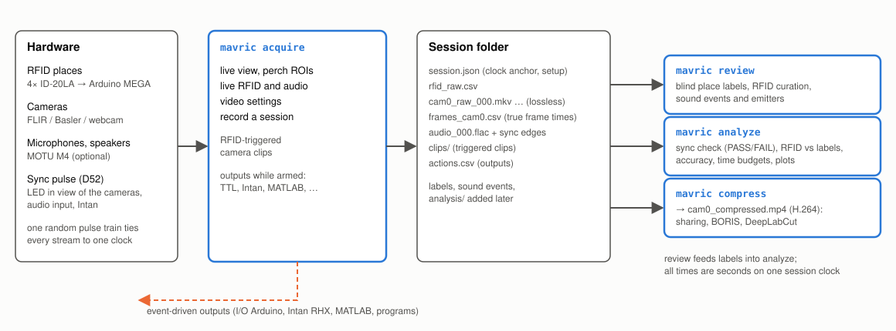

# MAVRIC

**Multimodal Audio-Video-RFID Interaction and Control.** A behavioural suite: synchronized video, audio and RFID
identification of individual subjects, with event-driven outputs for task control and interaction.
Version 0.8.0 · MIT licence · Windows 10/11 · Python 3.12

MAVRIC records RFID-tagged subjects at one or more *places* (wherever an RFID antenna reads tags: a perch, a
feeder, a nest box, a doorway) with cameras and microphones on a single clock. It checks that clock with a random
sync pulse, and lets people label the video blind. It then measures how well RFID matches the labels, and prepares
the video for DeepLabCut. It can also trigger video clips and external devices (TTL, Intan, MATLAB) when a chosen
subject arrives at, stays at or leaves a place.



**Contents:**
1. [Install](#install)
2. [Try it without hardware](#try-it-without-hardware)
3. [Hardware](#hardware)
4. [Acquire](#1-acquire)
5. [Review and label](#2-review-and-label)
6. [Analyze](#3-analyze)
7. [Compress video](#4-compress-video-and-deeplabcut)
8. [Commands](#commands)
9. [Files](#files)
10. [Troubleshooting](#troubleshooting)
11. [More documentation](#more-documentation)
12. [Licence and citation](#licence-and-citation)

---

## Install

**Requirements**
- Windows 10/11, 64-bit. Linux and macOS should work for review and analysis, but are untested.
- [Miniconda](https://docs.conda.io/en/latest/miniconda.html) or Miniforge.
- For acquisition: USB 3 ports for the cameras, plus enough disk space for raw video (about 50 GB per camera-hour
  at 1280×1024, 30 fps).

**Steps.** Run these in the *Anaconda Prompt (miniconda3)*:

```bash
git clone https://github.com/JesusJBallesteros/MAVRIC.git
cd MAVRIC
conda env create -f environment.yml
conda activate mavric
pip install --no-deps -e .
mavric --version
mavric selftest
```

The last two commands check the installation; `mavric selftest` runs the tests in about 2 minutes.

From then on, `conda activate mavric` gives you the `mavric` command.
- **Update:** `git pull` and `conda env update -f environment.yml --prune`.
- **Run from any folder:** `conda env config vars set MAVRIC_ROOT=<path to MAVRIC>` makes `mavric` find `config/` and
  `sessions/` from anywhere.

**Dependencies.** `environment.yml` installs them all:

| Package | Used for |
|---|---|
| numpy, pandas, pyarrow, matplotlib | data, analysis, plots |
| PySide6, pyqtgraph | windows, live plots |
| PyAV (FFmpeg), opencv-python-headless | video recording, reading, compression |
| sounddevice, soundfile | audio (ASIO-capable PortAudio, FLAC) |
| pyserial, PyYAML | Arduino link, configuration |
| pypylon | Basler cameras |
| pytest | `mavric selftest` |

**Optional, per hardware:**

| For | Install |
|---|---|
| FLIR / Point Grey cameras (Chameleon3, Blackfly S) | Spinnaker SDK, then its Python 3.12 PySpin wheel: `pip install --no-deps spinnaker_python-…-cp312…whl` ([details](docs/reference.md#flir--point-grey-cameras-chameleon3)) |
| Basler cameras | pylon Software Suite (drivers) |
| MOTU audio interface | MOTU driver (ASIO) |
| MATLAB outputs | `pip install "<matlabroot>\extern\engines\python"` in the `mavric` environment |
| Flashing the Arduinos | Arduino IDE 2 or `arduino-cli` |

## Try it without hardware

Everything has a simulated twin: five tagged subjects moving between four places, cameras, an RFID Arduino,
microphones and the sync pulse.

```bash
mavric acquire --sim                         # live window with the simulated cage
mavric simulate sessions --audio             # write a complete simulated session (with ground truth)
mavric review sessions/<that session>        # label it
mavric analyze sessions/<that session>       # sync check and RFID vs labels
```

## Hardware

Wiring, pin maps and the bring-up order are in [docs/wiring.md](docs/wiring.md).


**Firmware**
- **RFID Arduino MEGA:** `firmware/MultiRFID_Reader_ID20LA_sync`.
- **I/O Arduino** (optional, for outputs): `firmware/MAVRIC_IO`.

Flash them with:

```bash
arduino-cli compile --fqbn arduino:avr:mega firmware/MultiRFID_Reader_ID20LA_sync
```

```bash
arduino-cli upload --fqbn arduino:avr:mega -p COM3 firmware/MultiRFID_Reader_ID20LA_sync
```

**Check each part on its own before recording:**
- `mavric link-test --port COM3`: RFID lines
- `mavric camtest --cam cam0`: camera
- `mavric audio test`: audio
- `mavric outputs test io`: I/O Arduino

---

## 1. Acquire

```bash
mavric acquire
```


| | Control | What to do |
|---|---|---|
| 1 | **Devices** | Pick the RFID port and *Connect RFID*. Pick each camera and *Connect camera*. *Connect audio* if used. *View* picks the camera shown. *Video settings…* sets exposure, gain, size and recording format. |
| 2 | **Audio inputs** | Level per input, with a red CLIP warning, and a counter of the sync pulses received. |
| 3 | **Place ROIs** | Once per setup, on the first camera: *Draw / reset* one ROI per antenna, then the sync LED box, then *Save ROIs to rig*. |
| 4 | **Live RFID** | The tag at each place and for how long; arrivals and departures below. |
| 5 | **Recording** | Name and notes, then *Start recording*. Everything goes to `sessions/<date>_<name>/`. |
| 6 | **Outputs** | *Outputs…* holds devices, rules and camera clips. Nothing fires until *Arm outputs*. |
| 7 | **Live view** | A place ROI takes the subject's colour while its antenna reads the tag. |
| 8 | **Spectrograms** | The last 10 s of each microphone. |
| 9 | **Help / About** | The basics, the manual, the version and the licence. |

Every control explains itself when you hover over it.

**Before a real recording, check that:**
- each ROI lights up when you hold a tag at its antenna;
- the sync LED box brightness jumps every 2–6 s;
- the audio meters move (if audio is used);
- the window's top line shows no warnings.

**All cameras at once.** Set *View → All cameras* to see each camera with its frame rate and recording state. A
clip in progress shows as ● CLIP.


**Video settings.**
- **Camera settings (1):** exposure, gain, brightness and gamma change live (⚡). Frame rate, image size and
  pixel format reconnect the camera (2).
- **Recording format (3):** *raw* is the default. Every frame is kept bit-exact (lossless FFV1), in files of about
  2 GB. *H.264* records compressed straight away (about 1 GB/h, lossy).
- **Compression defaults (4):** used by `mavric compress` and the *Compress…* buttons.


**Outputs and camera clips.**
- **Rules:** when RFID sees a matching subject, a device acts. The device can be an I/O Arduino pin, Intan RHX, MATLAB,
  a program or a network message. A rule can act on arrival, on departure, or for as long as the subject is present.
- **Camera clips:** record video on a camera while a matching subject is present. The clip includes a few seconds
  before the first read.


## 2. Review and label

```bash
mavric review sessions/<session>
```


| | Part | Use |
|---|---|---|
| 1 | **Video** | The frame at the playhead. ROIs show the labeled subject (and RFID in curate mode). |
| 2 | **Timeline** | Label lanes, plus RFID lanes in curate mode. Click to seek, wheel to zoom. Grey = time you reviewed. |
| 3 | **Waveform** | Both microphones with the sound events, coloured by emitter. Dashed = automatic proposals. |
| 4 | **Spectrograms** | One per microphone, when the view spans 60 s or less. |
| 5 | **Mode** | *Blind* hides RFID while you label. *Curate* shows it and finds disagreements. |
| 6 | **Place** | The place your number keys label. |
| 7 | **Subject keys** | Which number is which subject. |
| 8 | **Playback** | Play, speed, follow. |
| 9 | **Session** | Save, Analyze, Render annotated video, Compress videos. |
| 10 | **Sound events** | Type, emitter with suggestions, proposals, listening, import/export. |

**Keys**

| Place labels | | Sound events | |
|---|---|---|---|
| ↑ ↓ | choose the place | S / E | start / end an event |
| 1–9, 0 | this subject is at the place from now / empty | F1–F9 | event type |
| Del | remove the change point | Alt+1–9, Alt+0 | emitter: subject / unknown |
| Space | play / pause | A | use the suggested emitter |
| ← → | 1 frame (Shift 1 s, Ctrl 10 s) | Y / R | accept / reject a proposal |
| [ ] | slower / faster | , . | previous / next event |
| N P | next / previous change | L | listen |
| D | next disagreement (curate) | Shift+Del | delete the event |
| X / V | RFID bout spurious / valid (curate) | Ctrl+S | save (also every minute) |

**How labels count**
- **Ground truth:** only time you actually watched counts. Label blind first, then curate.
- **Emitter suggestions** combine which microphone heard the sound louder with the subjects RFID detected at each
  place at that moment. Set `audio.mic_near` in `rig.yaml` (which antennas each microphone is next to) so the
  suggestions can be ranked.

## 3. Analyze

```bash
mavric analyze sessions/<session>
```

The report covers:
- the clock fits;
- the sync check (**PASS**/FAIL), which matches the sync LED seen by the camera, and the pulses recorded on the audio
  input, against the RFID log;
- RFID accuracy against your labels (sensitivity, precision, identity, κ);
- bout timing, time budgets, sound-event counts.

Tables and plots go to `analysis/`.


## 4. Compress video and DeepLabCut

Raw video is never changed. Compression writes `<name>_compressed.mp4` next to it:
- **Same frames:** every frame, in order, at a constant frame rate, so `frames_<cam>.csv` still times each one.
- **Fixed keyframes:** one every 30 frames, so frame seeking stays exact.

```bash
mavric compress sessions/<session>                  # H.264, CRF 18
mavric compress sessions/<session> --downscale 2    # half size: faster DeepLabCut
mavric compress D:/videos --crf 23 --preset slow    # any folder of videos
mavric compress sessions/<session> --print-ffmpeg   # show the equivalent ffmpeg commands
```

**Why these defaults:** DeepLabCut's own re-encoding guidance uses H.264 at CRF 18–23. It extracts frames by seeking
with OpenCV, which needs regular keyframes. Its developers also recommend small frames; for 1280×1024 cameras,
`--downscale 2` gives 640×512. Train and analyse on videos compressed the same way.

Sources: [DLC video tips](https://deeplabcut.github.io/DeepLabCut/docs/recipes/io.html#tips-on-video-re-encoding-and-preprocessing),
[Mathis & Warren 2018](https://www.biorxiv.org/content/10.1101/457242v1.full-text).

---

## Commands

| Command | Does |
|---|---|
| `mavric acquire [--sim]` | acquisition window (`--headless --duration 60` records without a window) |
| `mavric review <session>` | labeling, curation, sound events |
| `mavric analyze <session>` | sync check, RFID vs labels, plots |
| `mavric render <session>` | annotated video |
| `mavric compress <session or folder>` | `<name>_compressed.mp4` copies |
| `mavric sounds detect\|export\|import <session>` | sound-event proposals, Audacity / Raven exchange |
| `mavric import-boris <session> <file.tsv>` | BORIS labels as ground truth |
| `mavric simulate [--audio]` | a complete simulated session |
| `mavric ports` | serial ports and FLIR / Basler cameras |
| `mavric link-test`, `camtest`, `audio test`, `outputs test` | bench checks |
| `mavric selftest`, `mavric --version` | tests, version |

Each command accepts `--help`.

## Files

**Configuration** (`config/`). The first run copies the examples in `config/examples/` to `config/`; edit those
copies. Git ignores them, so your tag IDs, camera serials, ports and ROIs stay on your computer.

| File | Holds | Edited in |
|---|---|---|
| `rig.yaml` | ports, antennas, cameras, audio, sync | text editor |
| `video.yaml` | camera and recording settings (override `rig.yaml`) | *Video settings…* |
| `outputs.yaml` | output devices, rules, camera clip rules | *Outputs…* |
| `tags.csv` | tag ID → subject name and colour | text editor |
| `rois.json` | place ROIs and the sync LED box | *Save ROIs to rig* |
| `sound_types.yaml` | sound event types | *Types…* in review |

**A session folder**

```
sessions/20261023_101500_demo/
  session.json              setup, clock anchor, cameras, audio, clips, stats
  rfid_raw.csv              every RFID line, with host and Arduino time
  cam0_raw_000.mkv …        raw video (lossless), frames_cam0.csv = true time of every frame
  cam0_compressed.mp4       after mavric compress
  audio_000.flac            microphones + sync pulse; audio_clock.csv, audio_edges.csv
  clips/                    RFID-triggered clips
  actions.csv               every output decision
  manual_labels.csv, label_coverage.csv, sound_events.csv, sound_coverage.csv   from review
  analysis/                 from analyze
```

All times are seconds on one session clock. Everything is CSV, JSON or standard media files, so MATLAB, R and
Python read it directly.

## Troubleshooting

| Problem | Try |
|---|---|
| No RFID lines | `mavric link-test --port COMx`; the RFID supply ground must be joined to the Arduino GND |
| A place shows a subject that left | the TIR wire touches D0 or floats: check it, or add a 47 kΩ pull-down ([wiring](docs/wiring.md)) |
| Camera not found / busy | close SpinView; `mavric ports`; `mavric camtest --cam cam0` |
| Sync check FAIL | the LED must be in view, with the SYNC box drawn over it; the sync pulse must last ≥ 2 frames |
| Audio overflows | raise `audio.block` or `latency` in `rig.yaml`; `mavric audio test` |
| Disk filling | raw video takes about 50 GB per camera-hour: compress, or record H.264 |

## More documentation

- [docs/reference.md](docs/reference.md): every option, the formats, how the synchronization works.
- [docs/wiring.md](docs/wiring.md): wiring, pin maps, sync LED options, audio, bring-up.
- Plans and design records:
  - [outputs](docs/outputs_plan.md)
  - [audio](docs/audio_plan.md)
  - [implementation](docs/implementation_plan.md)
  - [project brief](docs/project_brief.md)
- Screenshots in this README come from simulated data: `python tools/make_screenshots.py`.

## Licence and citation

© 2026 Jesus J. Ballesteros, Neural Basis of Learning Lab, Institute of Cognitive Neuroscience (IKN), Ruhr-Universität Bochum.

MAVRIC is released under the [MIT licence](LICENSE), with one exception: the RFID firmware derived from
[MultiRFID](https://github.com/JesusJBallesteros/MultiRFID) is GPL-3.0-or-later. Dependencies keep their own licences
([THIRD_PARTY.md](THIRD_PARTY.md)).

To cite it, see [CITATION.cff](CITATION.cff).
