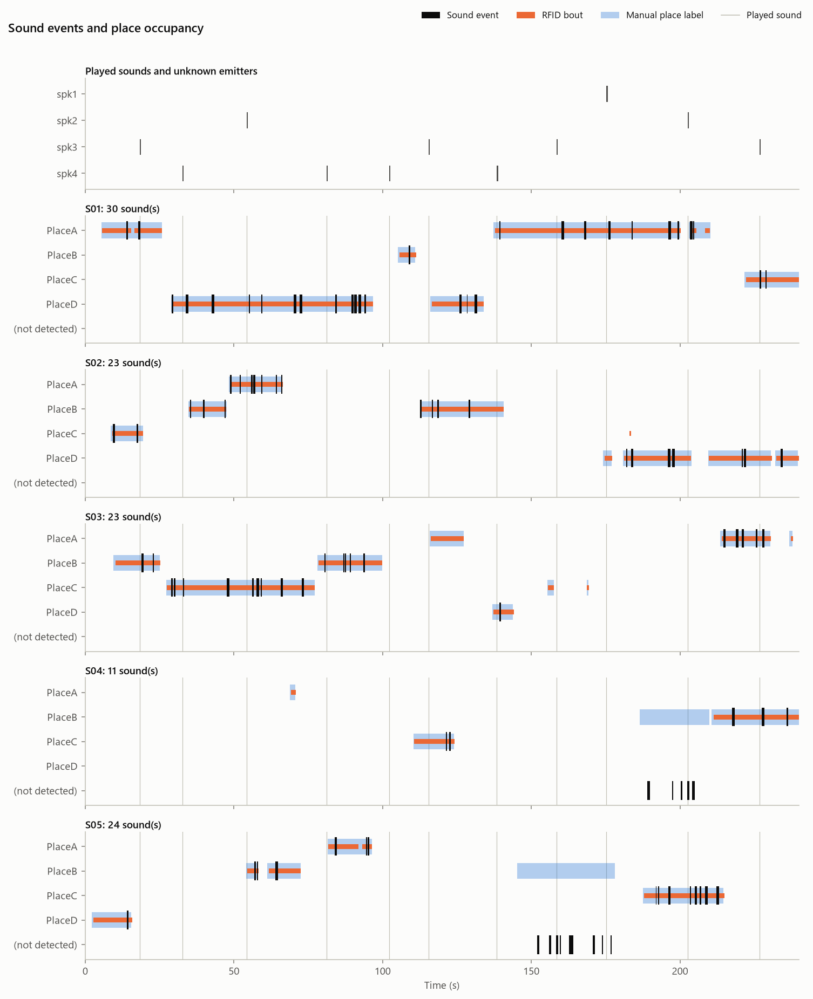

# MAVRIC reference

> Every option in depth, the file formats and how the synchronization works. The user manual is the
> [README](../README.md); installation is in [installation.md](installation.md), configuration and device setup in
> [quickstart.md](quickstart.md), wiring in [wiring.md](wiring.md).

**What it does.** MAVRIC records RFID-tagged subjects at *places* (wherever an RFID reader sees tags) with cameras and
microphones on one clock. It checks that clock with a random sync pulse, supports blind human labeling of place
occupancy and sound events, validates RFID against the labels, and drives outputs (sounds, TTL, Intan, MATLAB,
programs, network messages, camera clips) from RFID events. The result is trustworthy **subject × place × time**
records, with synchronized video and audio.

**Reference rig:** one cage, 4–5 tagged subjects, 4 places, each with one ID-20LA reader on an Arduino MEGA (the
[MultiRFID](https://github.com/JesusJBallesteros/MultiRFID) Arduino path), one or two industrial cameras, a MOTU M4
with two microphones and four speakers.

| Stage | What it does | Command |
|---|---|---|
| Acquire | Live cameras, place ROIs tied to antennas, live RFID and audio, synchronized recording | `mavric acquire` |
| Review | Blind ground-truth labeling of place occupancy; RFID curation; disagreement navigation; sound events (also for sessions without video) | `mavric review <session>` |
| Analyze | Clock sync + LED and audio validation, RFID bouts, accuracy vs labels, time budgets, sounds per subject and place, answers to played sounds, plots | `mavric analyze <session>` |
| Render | Annotated video (ROIs, RFID ID, label, disagreements; the sound and a spectrogram strip) | `mavric render <session>` |
| Timeline | Audio on the video's clock and Audacity label tracks, for Audacity, Ethograph and BORIS | `mavric timeline <session>` |
| Compress | H.264 copies of the raw video, every frame kept, for sharing and DeepLabCut | `mavric compress <session>` |
| BORIS stopgap | Use BORIS labels as ground truth | `mavric import-boris <session> <export.tsv>` |
| Triggered clips | Record video only while RFID detects a tag (any camera, incl. ones not used for ID) | acquire → **Outputs…** → Camera clips |
| Outputs | Drive TTL lines (Intan, LEDs, relays), Intan RHX, MATLAB, programs, network messages or sounds from RFID events | acquire → **Outputs…**, `mavric outputs` |
| Sounds | A stimulus library played by hand (soundboard) or by rules, logged to the sample | `mavric audio sounds`, `mavric audio play` |

## Install

[installation.md](installation.md) covers a new PC from scratch. A few details for other set-ups:

- **The environment** ([`environment.yml`](../environment.yml)) uses conda-forge packages only (no Anaconda
  `defaults` channel), Python 3.12 (which keeps DeepLabCut 3.x usable later) and a few PyPI wheels, explained in the
  file.
- **Tests:** `mavric selftest` runs the suite from any folder; extra pytest arguments pass through, e.g.
  `mavric selftest -k sync`. A plain `pytest -q` also works, but only from inside the project folder.
- **Removing:** `conda env remove -n mavric`.
- **Without conda (alternative):** a plain virtual environment also works:

```bash
uv venv .venv --python 3.12
```

```bash
uv pip install --python .venv/Scripts/python.exe -e ".[gui,basler,dev]"
```

**Troubleshooting**
- **`pytest` shows hundreds of collection errors** (numpy import errors from other programs' folders, `PermissionError`
  on `My Documents`, `Local Settings`, ...): pytest was started outside the project folder, and scans every folder
  below the current one. Run `mavric selftest` instead, or `cd` into the project folder first.
- **"Could not load the Qt platform plugin"** usually means a second OpenCV with its own Qt got into the environment.
  Fix it with `pip uninstall opencv-python`, keeping `opencv-python-headless`.
- **Keep pip from replacing conda packages:** install MAVRIC with `pip install --no-deps -e .`. Without `--no-deps`,
  pip may pull a second copy of numpy or Qt from PyPI.

## Cameras

- **Basler:** install the **pylon Software Suite** from Basler (USB3 / GigE drivers, pylon Viewer). The environment
  already contains `pypylon`, the Python binding. `mavric ports` lists the cameras it detects.
- **FLIR / Point Grey (Chameleon3, Blackfly S, ...):** needs the Spinnaker SDK and PySpin; see below.
- **Webcams:** `backend: opencv`, `device: 0` (the camera index). No hardware timestamps, so timing is host-only.
- **IDS (peak):** the adapter is a stub in `mavric/video/backends.py`. Implement it like `FlirCamera`
  (`mavric/video/flir.py`): return the hardware timestamp and frame id with every frame.
- **Check any configured camera** before recording: `mavric camtest --cam cam0`. It reports the measured fps, drops,
  the hardware-clock fit and any sync warnings, and saves a snapshot to `sessions/_camtest_cam0.png`.

### Camera calibration

**The board** is a ChArUco board (`calibration.board` in `rig.yaml`): a checkerboard whose white squares each hold
an ArUco marker.
- **Layout:** board coordinates are millimetres from the outer corner of the top-left square, which is black, with x
  to the right and y down. Marker *k* sits in the *k*-th white square, row by row (OpenCV's layout).
- **Why markers:** every corner gets an identity, so a partly hidden or partly visible board still counts, and
  cameras agree on which corner is which. That matters for an even × even board, which looks the same turned by
  180°.
- **Accuracy:** corner positions come from the checkerboard squares (to a fraction of a pixel); the markers only
  identify them. A sticker a millimetre off therefore costs no accuracy.

**Stickers for a plain checkerboard:** `mavric calibrate sheet [--out file.pdf] [--paper a4|letter]`.
- **Page 1:** the steps and a map of the board with each sticker's id, columns A–H and rows 1–10.
- **The other pages:** the stickers, with every marker drawn as vector cells at exact size, a dashed cut line
  (marker + 4 mm white margin, at most the square − 2 mm) and the id with ▲ arrows towards the top of the board.
- **Check the print:** each page has a 50 mm bar.
- **Check the stuck board:** `mavric calibrate check --cam cam0` (or `--image file.png`) reports markers and corners
  found. A sticker in the wrong square or turned is named; the acquire dialog shows it in red.
  - **How it's found:** each marker is compared with a homography fitted to its neighbours within two squares, so
    lens distortion does not matter, and a marker that misses by more than half its side is flagged.
  - **What happens to it:** flagged markers and their corners are left out, and the rest of the board is still used.

**Lens calibration** (Acquire → *Calibrate cameras…*):
- **Auto-capture:** a view is captured when the corners have moved less than 0.8 px for 5 frames in a row, and the
  board's position, size, tilt or roll differ enough from every captured view.
  - Views with a misplaced sticker or fewer than 12 corners are never captured.
  - *Capture now* (Space) takes the current view.
- **The fit:** `cv2.calibrateCameraExtended` with the standard (k1 k2 p1 p2 k3) or rational distortion model. Views
  with more than 3 × the median error (and over 1 px) are dropped once and the fit is repeated.
- **PASS** needs all of:
  - error ≤ 0.5 px RMS;
  - ≥ 12 views;
  - corners in ≥ 60 % of an 8 × 6 grid of image cells;
  - ≥ 4 tilted views (one board edge ≥ 13 % longer than the opposite one).
- **Result:** `config/calibration.yaml` → `cameras: <id>: lens:` holds:
  - `K` (3 × 3) and `dist`;
  - `rms_px`, the error of each view, `std_px` (the standard deviation of fx, fy, cx, cy);
  - `image_size`, `model`, the camera's `serial`, `date`, and the board.

  `config/calibration/<id>_lens.npz` keeps the corners of every view used, so the fit can be redone.
- **Offline:** `mavric calibrate lens --cam cam0 --images <folder> [--model rational] [--save]` calibrates from saved
  images. `mavric calibrate show` summarizes what is saved.
- **Validity:** a calibration holds while the lens, focus, zoom and image size stay the same. The dialog warns when
  the image size differs from the saved one.
- **Simulation:** in `mavric acquire --sim` the synthetic camera shows a simulated board moved by hand through a known
  lens. In 30 s it typically recovers the focal length within 0.3 % and the image centre within 2 px.

**Camera positions** (tab 2 of the dialog, `mavric/video/extrinsics.py`):
- **Snapshots:** the board held still where two or more cameras with a lens calibration see it (8 corners or more
  each), captured when it has been still in every one of them and is in a new position for at least one. The cameras
  run freely, so the board must be still; the frames need not be simultaneous.
- **Placing the cameras:**
  - **Board pose:** each view gives the board's pose in that camera (PnP: IPPE, then refined).
  - **Order:** the cameras are placed one at a time from the first camera (the ROI camera). Each new camera joins
    through the placed camera it shares the most snapshots with.
  - **Pair fit:** each pair is fitted on all the corners both cameras saw in the same snapshots (`cv2.stereoCalibrate`
    with the lenses fixed).
  - **Outliers:** snapshots whose cameras disagree by more than 3 × the median (and over 1 px) are left out once and
    the rig solved again: the board can start to move between two cameras' frames.
- **World frame:** the origin view is the board lying face up on the floor, seen by any placed camera.
  - **Axes:** the board's top-left outer corner is the origin, x runs along its columns, y towards its top edge and z
    up, in mm.
  - **Without an origin view:** the world is the first camera's own frame (x right, y down, z along its view).
- **Checks:**
  - **Against the other cameras:** each camera's corners are compared with the board as the camera with most corners
    in the same snapshot places it (px).
  - **3D:** corners are triangulated from two cameras and compared with the board's true shape after a rigid fit (mm,
    median and p95).
  - **PASS** needs every camera placed, ≥ 5 snapshots per joining pair, ≤ 1.5 px against the other cameras and a 3D
    error ≤ 2 mm.
- **Result:** `config/calibration.yaml` → `cameras: <id>: pose:` holds:
  - `T_world_to_camera` (4 × 4) and `centre_mm`;
  - `via` (the camera it joined through), `n_views`, `pair_rms_px` and `rms_px`.

  `world:` holds the frame, the date and the 3D error. Saving replaces every camera's position: positions from
  different solves would not share one world.
- **Simulation:** with several synthetic cameras (`mavric acquire --sim` and a `synthetic` entry per camera in
  `rig.yaml`), each camera gets its own lens and place around the cage, and the board moves between poses that two
  of them see. With the lenses calibrated in tab 1, the positions come out within a few millimetres of the truth.

**Places in 3D** (tab 3 of the dialog, `mavric/video/places.py`):
- **Needs:** the ROI camera's lens and position, and positions saved with a floor origin (heights are measured from
  it). The ROIs must be drawn at the image size the ROI camera was calibrated at.
- **A place** is its polygon in the ROI camera, carried along that camera's rays onto the horizontal plane at its
  height (`plane_z_mm`). Draw the outline of the surface the subjects stand on.
  - **Box:** with `box_mm`, the place is the box that tall standing on its surface. In another camera its outline is
    the outline of the whole box, so it covers a subject standing on the place.
  - **The sync LED** is a point: its box's centre in the ROI camera, carried to the LED's height.
- **Finding a height:**
  - **Typed:** a measured height in mm.
  - **Marked in two cameras:** a spot clicked in the ROI camera, then the same spot in another camera. After the
    first click, the dashed line shows where that spot can be in the other cameras (its ray, bent by the lens). The
    two rays are triangulated, and the spot's height becomes the place's height. Clicks whose rays pass more than
    25 mm apart are refused.
- **Every camera:** each placed camera shows each place it sees: in its live view, the *All cameras* view, review and
  the rendered video. Places outside its view are left out. The ROI camera always shows the ROIs exactly as drawn,
  and they are drawn and edited only there.
- **Saved** in `config/rois.json`, per ROI: `plane_z_mm`, `box_mm` and `points3d` (the outline in the world, mm).
  Editing a polygon and saving works the 3D outline out again from its height. Older files load unchanged (no
  heights).
- **Sessions:** a recording copies `config/calibration.yaml` into its folder, so its places can be shown from every
  camera later. Each camera that sees the sync LED records its brightness (`led_mean`).
- **Simulation:** with two or more synthetic cameras the simulated cage is 3D. Its perches stand at 160 and 320 mm
  and its LED at 300 mm, and every camera sees them from its own place. *Use the true heights (simulation)* fills
  them in.
- **Not covered:** sloping or vertical surfaces (a place is a horizontal surface or a box on one).

**Microphones and speakers** (tab 4 of the dialog, `mavric/audio/geometry.py`, `mavric/audio/ranging.py`):
- **Needs:** camera positions with a floor origin. The places placed in 3D are shown and used, but not required.
- **The space view:** from above (x, y) and from the side (x, z), in mm, with the floor origin, the places, the
  cameras and every microphone and speaker of `rig.yaml` (`audio: inputs` and `speakers`). The view reaches past what
  the cameras see, so devices out of view are placed the same way.
- **Placing a device:** drag it in either view, or type x, y, z. Its aim is an azimuth (from +x towards +y) and an
  elevation (up from the horizontal), in degrees.
  - **Suggested layout:** speakers beyond the corners of the places, aimed at their middle; the two microphones
    above the long midline, at a quarter and three quarters of its length, facing opposite sides.
  - **Aim at the places:** points every device at the middle of the places.
- **Check with sound** (the audio connected, not recording): each speaker plays a 50 ms sweep (1–16 kHz, or
  12–20 kHz above pigeon hearing), 3 times.
  - **Arrival:** each microphone's recording is matched against the sweep; the first strong peak is the direct
    sound (later peaks are reflections). The delay after the driver's reported round trip is the air path plus one
    constant the driver does not report (converter latency): `t = distance / c + L`. Here c is the speed of sound
    at `audio.temperature_c` (default 20 °C, 343 m/s).
  - **The check:** with the typed positions, L is fitted and each pair's distance compared: **PASS** needs ≤ 30 mm
    RMS and no pair over 60 mm. The largest disagreements point at the device to check.
  - **Fit positions:** moves the ticked kind of device (microphones, speakers) and L to agree with the sounds. Each
    device is held near its typed position (± 250 mm per axis); the result gives each one's uncertainty per axis.
    With four speakers at one height, a microphone's height stays mostly where it was typed.
  - **Levels:** how strongly each sweep arrived, after the distance and the microphone's cardioid pickup. A least
    squares fit over all pairs gives each microphone's recording gain relative to the first microphone, and each
    speaker's output relative to the first speaker. The speakers' own directivity is not modelled; it shows in the
    residual (dB RMS). Measured again after *Use the fitted positions*.
- **Places as the microphones hear them:** for a call from each place (60 mm above its surface), the arrival-time
  difference between the two microphones and the level difference. They come from distance, the cardioid pickup and
  the microphones' measured gains, with how much each varies over the place's outline (±). Two places within
  0.25 ms and 3 dB of each other are flagged as hard to tell apart. Review grades the emitter suggestions by these
  (see [Label](#2-label-mavric-review-session)).
- **Speaker level at each place:** each speaker's level at a bird's head above each place, in dB relative to 1 m in
  front of the first speaker, from the distance and the speaker's measured output. The angle off each speaker's
  axis is shown. Not included: the speakers' directivity and the room's echoes.
- **Saved** in `config/calibration.yaml` → `devices: <name>:` holds `kind`, `position_mm`, `aim_deg` and `placed`
  (`typed`, `suggested` or `sound`, with `sd_mm` after a fit), and `level_db` once measured. `devices_meta:` holds
  the date, the date of the camera world the positions belong to, and the last sound check and fit. Sessions copy
  the file with the devices. `mavric calibrate show` prints the devices, the places as the microphones hear them and
  the speaker level at each place.
- **Simulation:** in the 3D simulated cage the devices have true positions (*True positions (simulation)*). The
  simulated interface delays and attenuates each speaker → microphone path by its distance and the cardioid
  pickup, adds a floor reflection and a 0.6 ms latency it does not report. micB records 2 dB quieter and spk4 plays
  3 dB quieter. The check finds that latency and both levels (within 0.3 dB), and fits the microphones from the
  suggested layout to within about 15 mm. `mavric simulate --audio --places-3d` writes a session whose places,
  microphones and speakers are in 3D, with calls that reach each microphone by distance and pickup.

**Did a camera move?** (`mavric/video/drift.py`; the acquire window's *Position*, *Alignment overlay* and *New
reference*):
- **The reference view:** one grayscale picture per camera, `calibration/reference_<cam>.png` next to
  `calibration.yaml`. It is the view the ROIs and the camera position were made for.
  - *Save ROIs to rig* removes the ROI camera's reference; *Save positions* removes those of the cameras placed.
  - A camera without a reference gets one at the start of the next recording, noted in `session.json`
    (`reference_views_taken`). *New reference* takes it by hand.
  - Sessions copy the references next to their `calibration.yaml`.
- **The measurement:** the picture now against the reference, as a rotation + shift (+ scale).
  1. The whole pictures are aligned (ECC, coarse to fine, at most 480 px wide). Moving birds hardly count, and a
     change of light not at all.
  2. ORB details are matched near where that alignment puts them, a few per part of the picture, with and without
     the parts that changed (birds that moved), and fitted with RANSAC. Repeating structures (identical perches,
     wire mesh) are fine, because each detail is only looked for nearby.
  3. Of these alignments, the one under which the picture's edges agree best counts.
  The result is how far the picture's corners and middle moved at most, against its diagonal: under 0.5 % in place,
  under 2 % *shifted a little*, else *moved*. It takes about 0.1 s per picture.
- **While acquiring:** every connected camera every 10 s, in the background. The middle of the last three
  measurements counts, so one picture with a bird close to the lens does not warn.
  - At the start of a recording each camera is noted in the session (`cameras[].position_check`); a camera not in
    place adds a warning.
  - While recording, each change of level is noted (`position_checks`: `t_s`, `camera`, the shift) and shown in the
    status line.
  - Review shows these at the top of its side panel.
- **Alignment overlay:** the reference's edges (Canny) in magenta over the live picture of the camera shown. An
  arrow goes from where the middle of the picture is to where it belongs, and the status line gives the shift
  (measured about once a second).
- **Analysis:** `mavric analyze` measures 7 pictures spread over each camera's recording. A camera counts as moved
  from the first of the pictures after which every one says so (the middle of the last three decides), reported as
  "since between m:ss and m:ss". It also says whether the sync LED still flashes in its box. Details are in
  `analysis/camera_positions.json`.
- **Simulation:** `SimWorld.moved[camera] = (dx px, dy px, degrees, from t)` bumps a simulated camera;
  `simulate_session(camera_moved=...)` does it in an offline session.

### FLIR / Point Grey cameras (Chameleon3, Blackfly S)

The `flir` backend (`mavric/video/flir.py`) drives FLIR / Point Grey USB3 cameras through **Spinnaker** (PySpin).
FlyCapture2, the SDK in the 2015 Chameleon3 manual, is no longer developed. The Chameleon3 USB3 and the Blackfly S
USB3 are supported by Spinnaker.

**1. Install the Spinnaker SDK.** Download it from Teledyne FLIR (free account): *Spinnaker SDK, Windows x64*.
Install it with the **USB3** driver. Check that **SpinView** shows the camera and streams.
- If features are missing, update the camera firmware from SpinView.

**2. Install PySpin into the `mavric` environment.** From the same download page, get the **Python** package for
**the same SDK version** and **Python 3.12** (`spinnaker_python-<version>-cp312-cp312-win_amd64`). Unzip it, then:

```bash
conda activate mavric
pip install --no-deps spinnaker_python-<version>-cp312-cp312-win_amd64.whl
python -c "import PySpin; v = PySpin.System.GetInstance().GetLibraryVersion(); print(v.major, v.minor, v.type, v.build)"
mavric ports
```

- `--no-deps` keeps conda's numpy. If `import PySpin` complains about numpy, use the numpy version named in the
  wheel's README.
- The wheel must match the installed SDK version, otherwise you get an import error or crashes.

**3. Configure the camera in `config/rig.yaml`:**

```yaml
cameras:
  - id: cam0
    backend: flir
    device: ""           # serial number from `mavric ports`, or "" for the first camera
    fps: 30
    exposure_us: 8000
    gain_db: 0.0
    pixel_format: Mono8  # colour models: BGR8, or BayerRG8 (colour made on the PC)
    line_status: false   # Chameleon3, BFS-U3-16S2: no per-frame line-status chunk
    white_balance: once  # colour models: once, continuous or off
```

Then run `mavric camtest --cam cam0`.

**Chameleon3 models**

| Model | Max frame rate | Fit for MAVRIC |
|---|---|---|
| **CM3-U3-13Y3M/C** (1280×1024, CMOS, global shutter) | 91 fps Mono8, 50 fps RGB | Best fit |
| **CM3-U3-13S2M/C** (1288×964, CCD) | 30 fps | Fine |
| **CM3-U3-28S4M/C** (1928×1448, CCD) | 13 fps full frame (24 fps at 964×764 binned mono, 25 fps at 800×600) | Only marginal |

All models are global shutter, which gives no motion distortion with flapping wings.

- **28S4 at 13 fps:** lengthen the firmware `SYNC_PULSE_US` to ≥ 160 000, and set `sync.led_pulse_s: 0.16` to match.
  `mavric camtest` and the recording warn when the LED pulse covers fewer than 2 frames.

**Chameleon3 hardware notes**
- **Lens:** not included. The mount is CS; a C-mount lens needs the 5 mm adapter. Choose the focal length for the
  cage size and the sensor size (1/2" for the 13Y3, 1/3" for the 13S2).
- **USB 3.0 port:** use a PCIe 2.0 host controller or a built-in USB 3 port, with a 3–5 m cable. A 5 m cable is not
  recommended on laptops.
- **Bandwidth:** 1280×1024 Mono8 at 30 fps is about 39 MB/s per camera, so two cameras on one controller are
  normally fine. Each camera still sends every frame in a burst at full link speed, though, and some host controllers
  then lose packets. If a camera works alone but delivers only incomplete images next to another one, cap each
  camera's share with `link_limit_mb_s` (e.g. `150`) under that camera in `rig.yaml`. Or give it its own USB 3
  controller (a PCIe card).
- **A camera connects but shows no image:** the status line says `NO FRAMES for N s` and counts incomplete images
  and timeouts, with the last reason. Compare `mavric camtest --cam cam1` (alone) with `mavric camtest --cam all`
  (every camera at once).
  - **Incomplete images:** the USB link. Check that `usb=SuperSpeed` appears in the camtest output (not
    `HighSpeed`, which is USB 2: wrong port, cable or hub). If the problem appears only with `all`, set
    `link_limit_mb_s`.
  - **Incomplete images, "chunk data invalid" (`IMAGE_CHUNK_DATA_INVALID`):** Spinnaker can't parse the extra
    per-frame data that MAVRIC turns on for the camera's frame counter (seen with a Chameleon3). MAVRIC now turns it
    off by itself after 3 such images and keeps streaming; drops are then counted from the stream's frame IDs. To
    skip the attempt, set `chunk_frame_counter: false` for that camera. The camera keeps this setting until it is
    unplugged, so if SpinView shows the same error, unplug the camera once. MAVRIC now turns it back off when it
    disconnects.
  - **Timeouts:** the camera is not sending. The camtest warns if `TriggerMode` is still On, e.g. left on in a
    saved SpinView user set; turn it off in SpinView. Also close SpinView before connecting in MAVRIC.
- **Mounting:** mount the camera on a heat-conducting bracket (it runs warm). Operating range is 0–45 °C and 20–80 %
  humidity, non-condensing.
- **Mono vs colour:** mono models have no IR-cut filter and can work with 850 nm IR lighting. Colour models block IR
  above about 680 nm, but colour helps human labelling (fur or plumage, coloured markers).

**Sync on the Chameleon3**
- **Per frame:** the backend records the device timestamp (`TimestampIncrement` ns/tick) and the camera's
  `FrameCounter` chunk.
- **No per-frame GPIO state:** the Chameleon3's GenICam chunk list has no line-status entry, so the **sync LED in the
  image** validates video↔RFID timing. That is accurate to about ½ frame, which is enough for place presence.
- **Optional, for frame-exact sync later:** the opto-isolated input (Line 0, pin 9, 0–30 V) accepts the Arduino's 5 V
  sync signal; connect OPTO_GND (pin 7) first. The opto output (Line 1) can send *exposure active* to the Arduino.
  Using either needs firmware/software work and is not required now.

**Blackfly S BFS-U3-16S2C** (an option to try, not a default)
- **Works with the `flir` backend:** set `backend: flir` and its serial as `device`. The SDK, PySpin and USB 3 advice
  above apply unchanged.
- **The camera:** Sony IMX273, 1440 × 1080, global shutter, colour, up to 226 fps at 8 bit, 240 MB image buffer.
  The final C means colour; the BFS-U3-16S2M is the mono model.
- **Pixel format:**
  - `Mono8`: grey, made in the camera from the colour sensor. MAVRIC turns the camera's ISP on if needed. Same data
    and recording size as a mono camera.
  - `BayerRG8`: colour, made on the PC. Over USB it is as light as Mono8 (47 MB/s at 30 fps, full frame).
  - `BGR8`: colour made in the camera, 140 MB/s at 30 fps: two of them fill most of one USB 3 controller.
  - **Disk:** colour triples the raw video size and the encoding work compared with Mono8.
- **White balance** (colour models): `white_balance: once` (the default) measures it when the camera connects, then
  keeps it, so colours don't drift during a session. `continuous` lets the camera keep adjusting. `off` keeps it as
  it is, or sets `balance_red` / `balance_blue` (gains relative to green; `mavric camtest` prints the current ones).
  *Video settings…* changes it live.
- **Differences handled by the backend:** SFNC names (`AcquisitionFrameRateEnable`, `GammaEnable`), the frame
  counter from the `FrameID` chunk, timestamps in ns. `gamma: 0` keeps the response linear, as on the Chameleon3.
- **Sync:** this model has no per-frame line-status chunk either. Its chunks are image, CRC, frame ID, offsets, size,
  exposure, gain, black level, pixel format, timestamp, sequencer set and serial data. So the **sync LED in the
  image** validates the timing, as with the Chameleon3. The red sync LED passes the colour models' IR-cut filter.
- **GPIO:** 1 opto-isolated input and 1 opto-isolated output, 1 non-isolated bidirectional line and 1 non-isolated
  input. The opto input is the one for a future hardware frame trigger. Pin numbers are in the camera's reference
  (GPIO).
- **Lens:** CS-mount, as on the Chameleon3 (a C-mount lens needs the 5 mm adapter). The sensor is 1/2.9", smaller
  than the 13Y3's 1/2", so the same lens shows a narrower view: choose the focal length for that size.
- **Checked against FLIR's camera reference with a simulated camera, not yet on a real one.** On the first real
  camera, run `mavric camtest --cam cam0`. Look for `usb=SuperSpeed`, the pixel format and frame rate you set, no
  incomplete images, and the white balance line for colour models. Then make a 5-minute test recording: the LED/SYNC
  check in `mavric analyze` should say **PASS**.

## Try it without hardware

With the environment active (`conda activate mavric`):

```bash
mavric acquire --sim                 # GUI with a simulated cage + simulated Arduino
mavric simulate sessions --duration 300 --audio
mavric audio test --sim --tones      # simulated audio interface, speakers heard by the mics
mavric review sessions/<the simulated session>
mavric analyze sessions/<the simulated session>
```

**What simulated sessions contain:**
- ground truth (`ground_truth.csv`) and noisy "manual" labels
- a +145 ppm Arduino clock drift, which is the value measured on the real board
- RFID onset latency, dropouts and crosstalk
- camera frame drops
- the sync LED
- with `--audio`:
  - two microphones with calls (`ground_truth_calls.csv`)
  - the sync pulse on an AC-coupled line input
  - a +25 ppm interface clock

The test suite checks that the pipeline recovers all of these.

## Hardware

The full pin-map (ID-20LA module pins, MEGA pin usage, Chameleon3 GPIO connector) and the bring-up order are in
**[docs/wiring.md](wiring.md)**.

**Readers:** Arduino MEGA 2560 with 4× ID-20LA (integrated antenna). Wire them as in the MultiRFID
`Arduino Software/README.md`:

| Reader | MEGA RX pin | TIR pin |
|---|---|---|
| 1 | 19 | 2 |
| 2 | 17 | 3 |
| 3 | 15 | 4 |
| 4 | 10 (SoftwareSerial) | 5 |

**Sync pins:** D52, D50 and D48 give the same pulse ([docs/wiring.md §3](wiring.md)).
- **D52, sync LED:** D52 → 330 Ω → red LED → GND. Place it where every camera sees it; a small diffuser helps.
- **D50, audio:** a 10 kΩ / 1.8 kΩ divider into MOTU M4 In 3 (TRS: tip = signal, ring = GND).
- **D48, spare:** for Intan DIGITAL IN 2, or a camera input line for frame-exact sync (Basler: Line 1 opto-in,
  then set `line_status: true` in `rig.yaml`, and the camera records the line state with every frame).

**Firmware:** `firmware/MultiRFID_Reader_ID20LA_sync/`. It is the MultiRFID ID-20LA sketch plus:
- an LED pulse of 80 ms at random 2–6 s intervals, each logged as `<micros>,SYNC,0`;
- a `<micros>,BOOT,0` line at start-up;
- fixed-cadence sampling rounds.

The line format is unchanged, so `Multiple_RFID.m` still runs with this firmware; it shows SYNC/BOOT lines as `UNKNOWN`.

Flash it with:

```bash
arduino-cli compile --fqbn arduino:avr:mega firmware/MultiRFID_Reader_ID20LA_sync
```

```bash
arduino-cli upload --fqbn arduino:avr:mega -p COM3 firmware/MultiRFID_Reader_ID20LA_sync
```

(`arduino-cli.exe` ships with Arduino IDE 2 under `resources/app/lib/backend/resources/`.)

### Bring-up checklist (bench, before animals)

1. **Tags:** check they are 125 kHz EM4100. This path cannot read FDX-B.
2. **Readers and tag map:** run `mavric link-test --port COM3`. Hold each tag at each reader, then:
   - fill in `config/tags.csv` (tag → subject);
   - fill in `config/rig.yaml → antennas` (reader → place name).
3. **Read zone:** with the real tag mount (leg ring, collar, implant), measure the read range at the real distances
   and angles. The ID-20LA's built-in antenna has a short range, so its position decides where a subject is
   detected.
4. **Crosstalk:** in the final layout, check that a tag at one place is never read at its neighbour.
5. **Latency:** measure the time from landing to first read, and from leaving until the read clears.
6. **Camera:** every place and the LED in view, ≥25 fps, fixed exposure and gain, even lighting. Run
   `mavric camtest`: no drops, a measured fps equal to the configured one, and no warnings.
7. **Short test recording:** 5 min, moving tags by hand. In `mavric analyze`, the LED/SYNC check should say **PASS**.
8. **Long test recording:** ≥80 min, so the `micros()` wrap at 71.6 min is exercised. Drift should be stable.
9. **Audio** (if used): `mavric audio test --tones`, then a 5-minute recording. In `mavric analyze`, the audio line should
   say **PASS** ([docs/wiring.md §7](wiring.md)).

## Workflow

### 1. Acquire: `mavric acquire`
1. Connect the RFID reader and the camera. The live view runs before you record anything.
2. Draw **one ROI per antenna**. Choose *Draw / reset*, drag the corners, and click an edge to add a corner. Then draw the
   **sync LED box**.
3. Choose *Save ROIs to rig*, which writes `config/rois.json`.
4. Check the live view: an ROI lights up in the subject's colour while its antenna reads a tag, and the live table
   and event list show arrivals and departures. The LED box brightness must jump with each flash.
5. Enter a session name and notes, then record. Every stream is written to disk continuously, so a crash keeps
   everything up to the last second.

### Video settings, raw recording and compression

**Video settings… (acquire window, next to View).** Per camera:
- frame rate, exposure, gain, brightness (black level), gamma, pixel format, white balance (colour cameras);
- region of interest (width, height, offsets; a smaller image allows a higher frame rate and less data);
- continuous or clips-only recording.

Exposure, gain, brightness, gamma and white balance change live (⚡); the rest reconnect the camera. *Save* writes
`config/video.yaml`, which overrides `rig.yaml` (`rig.yaml` keeps its comments).

**Raw recording (default).** Every frame is kept bit-exact, in files of about 2 GB (adjustable):
- **Files:** `cam0_raw_000.mkv`, `cam0_raw_001.mkv`, …
- **Codec:** FFV1, lossless, about a third of the uncompressed size. Uncompressed AVI is the alternative.
- **Data rate:** at 1280×1024 and 30 fps, measured on cam0 (gain 0):
  - FFV1: about 50 GB per camera-hour
  - uncompressed: 142 GB per camera-hour

  Noisier images (higher gain) compress less.
- **Before recording:** the window warns when the disk has room for less than 2 h.
- **Inside a session:** review, analysis and rendering read the chunks directly.
- **Clips:** RFID-triggered clips are raw too.
- *H.264 while recording* is still available (about 1 GB/h, lossy).

**Compression (afterwards, raw files are kept).** Each recording becomes `<name>_compressed.mp4` in the same folder.
- **What it makes:**
  - `cam0_raw_000…` → `cam0_compressed.mp4`
  - `clips/cam1_rule_001_raw_000.mkv` → `clips/cam1_rule_001_compressed.mp4`
  - any other video → `<name>_compressed.mp4`
- **What it keeps:** every frame, in order, at a constant frame rate, so `frames_cam0.csv` still times each frame.
- **Where to run it:**
  - *Compress videos…* in `mavric review`
  - *Video settings → Compress a session…*
  - the command line

```bash
mavric compress sessions/<session>                     # H.264, CRF 18, keyframe every 30 frames
mavric compress sessions/<session> --downscale 2       # 640x512: smaller, faster DeepLabCut
mavric compress sessions/<session> --crf 23 --preset slow
mavric compress D:/videos                              # every video in a folder
mavric compress sessions/<session> --print-ffmpeg      # the equivalent ffmpeg commands
```

**For DeepLabCut**, the defaults follow DLC's own guidance:
- **Codec and quality:** H.264 MP4 at CRF 18–23. The re-encoding recipe in DLC's docs uses exactly this.
- **Keyframes and frame rate:** constant frame rate, and a keyframe every 30 frames. DLC extracts frames by seeking
  with OpenCV, which needs regular keyframes.
- **Frame count:** checked after encoding. DLC warns when metadata and real frame counts differ.
- **Frame size:** DLC's developers advise small frames. A 2× downscale (`--downscale 2`, 640×512 here) or a crop to
  the places speeds up training and analysis with little accuracy cost. Downscaled or cropped files no longer match
  the ROIs, so the review window keeps using the raw video.
- **Consistency:** train and analyse on videos compressed the same way.
- **Exposure:** short exposures avoid motion blur better than higher frame rates. Grayscale is fine.

Sources:
- [DLC video re-encoding tips](https://deeplabcut.github.io/DeepLabCut/docs/recipes/io.html#tips-on-video-re-encoding-and-preprocessing)
- [DLC user guide](https://deeplabcut.github.io/DeepLabCut/docs/main-workflows/user-guide.html)
- [Mathis & Warren 2018](https://www.biorxiv.org/content/10.1101/457242v1.full-text): robust to video compression and
  downsampling

### RFID-triggered clips (optional)

Use these to record video only while RFID detects a tag. This works on the main camera or on extra cameras not used
for identification, such as a close-up of one place.

**1. Add the camera to `rig.yaml`**, with its serial number (`mavric ports` lists the FLIR cameras):

```yaml
cameras:
  - id: cam0             # the first camera carries the place ROIs and the sync LED box
    backend: flir
    device: "12345678"
    record: continuous
  - id: cam1
    backend: flir
    device: "12345679"
    record: triggered    # nothing but clips; "continuous" also keeps the full video
```

**Pin every camera to its serial number** once there is more than one. `device: ""` means "the first camera found",
so two cameras would both pick the same one.

In the acquire window:
- **Connect camera:** pick each camera in the *Camera* list and connect it.
- **View:** chooses which connected camera is shown. *All cameras* shows every connected camera side by side for
  monitoring: frame rate, recording, clips only, and a clip in progress.
- **ROIs:** they are drawn on the first camera of `rig.yaml`, whatever the connection order. Once the places are
  placed in 3D (*Calibrate cameras…*, tab 3), the other cameras show them too, in their single view and in *All
  cameras*.

**How many cameras.** Measured on the cage PC (i7-11700K, one USB 3 controller), at 1280×1024 Mono8:
- **Encoding:** the PC encodes about 330 frames/s in total. Plan for about **6 continuous cameras at 30 fps**,
  or about 12 at 15 fps.
- **USB:** one controller carries about 384 MB/s, and each camera at 30 fps needs 39 MB/s.
- **Clips-only cameras:** they only cost encoding while a clip is recording.
- **Beyond that:** add a PCIe USB 3 card with one controller per port, and lower the frame rate or use 2×2
  decimation.

**2. Add rules: acquire → Outputs… → Camera clips.**
- **Each rule sets:** a camera, antennas, subjects, and the seconds before and after the presence.
- **Saving:** the rules go to `config/outputs.yaml` (`clips:`) and apply from the next recording.

The same rules can also be written in `rig.yaml`:

```yaml
triggers:
  - name: placeB
    camera: cam1
    antennas: [2]        # or "any"
    match: any           # or [S01, S03] (subject names) / tag IDs
    pre_s: 3             # from the camera's ring buffer, i.e. before the first read
    post_s: 5            # after the last read
    max_s: 300           # longer clips are split
```

**How clips behave:**
- A clip starts on the RFID round in which a matching tag appears.
- A matching arrival during the post-roll extends the clip.
- Subjects that are already present when recording starts trigger immediately.

**Where clips go:**
- Video: `clips/<camera>_<rule>_<nnn>.mp4`.
- Timing: `clips/<…>_frames.csv`, with the same columns and session clock as `frames_<cam>.csv`.
- Registry: `session.json["clips"]`, listing the trigger time, antenna, tag/subject, the number of frames taken from the
  ring buffer, and why the clip ended.

The acquire window shows each rule's state. `mavric analyze` writes `analysis/clips.csv`, which places every clip on
the session timeline (camera clock fit) and links it to the RFID bout that triggered it.

**Ring buffer memory:** pre_s × fps × frame size. For example, 3 s × 30 fps × 1 MB is about 90 MB per camera.

### Event-driven outputs (optional)

**What it does:** RFID events can drive other devices: TTL lines (Intan, LEDs, relays), Intan RHX, MATLAB, programs,
network messages and sounds on the speakers. Wiring is in [wiring.md §6](wiring.md#6-io-arduino-event-driven-outputs).

**Setup**
1. In the acquire window, open **Outputs…**.
2. **Devices tab:** add the devices.
3. **Rules tab:** add rules. Each rule sets:
   - which antennas (or any)
   - which subjects (or any)
   - the event: **on enter**, **on leave** or **while present** (a start/stop pair)
   - the device action
   - refractory period, delay, and maximum firings per minute
4. **Save** writes `config/outputs.yaml` and restarts the outputs.
5. Nothing is driven until you press **Arm outputs**. Disarming releases every held output.

**Device types**

| Device | Actions | Setup |
|---|---|---|
| **I/O Arduino** (`firmware/MAVRIC_IO`) | `pulse` (pin, ms) · `hold` (pin high while present) · `set` · `toggle` | Flash the sketch and set the COM port. Port `SIM` is a software emulator. |
| **Intan RHX** (TCP) | `record` · `run` · `stop` · `hold_record` (record while present) · `send` (any command) | In RHX: Network → Remote TCP Control → Commands, port 5000, Connect |
| **MATLAB** (Engine API) | `eval` (code) · `call` (function + args) · `run` (script) | `pip install "<matlabroot>\extern\engines\python"` in the mavric env, then in MATLAB `matlab.engine.shareEngine('mavric')` |
| **Program / script** | `run` with arguments | started once per action, without waiting for it to finish |
| **UDP / TCP message** | `send` · `hold` (start/stop texts) | e.g. to a MATLAB `udpport` listener, Bonsai, another PC |
| **Audio speakers** | `play` (sound, speakers, gain dB, loop) · `stop` (speakers or all) · `hold_play` (loop while present, fade out after) | Connect audio first; sounds come from the library (below) |
| **Simulated** | `mark` | logs only |

**Placeholders.** Texts and arguments accept `{event} {rule} {antenna} {roi} {subject} {tag} {t} {utc} {session}`
(`{pigeon}`, the older name of `{subject}`, still works).
`{t}` is the session time in seconds, so `{t:.3f}` gives milliseconds. A sound name accepts them too:
`{subject}_call` plays a different file for each subject.

**Logging.** Every decision is written to the session's `actions.csv`:
- `ok`, `error`, `dry` (not armed) or `suppressed` (refractory, rate limit)
- event time and send time, with the latency in between
- the I/O board's own `micros()` for each acknowledgement

`mavric analyze` adds `analysis/actions_summary.csv`: firings, errors and latency per rule.

**Command line**

```bash
mavric outputs list
mavric outputs test io
mavric outputs fire intan_placeB
mavric acquire --headless --sim --arm-outputs --duration 30
```

**Timing.** RFID presence events now reach the rules about 5 ms after a sampling round's lines arrive, instead of one
round later. In the simulator the rule → I/O board acknowledgement took about 11 ms in total. The firmware switches the
pin before acknowledging.

### Audio: two microphones and speakers (optional)

**What it does**
- **Records** the two Rode NT5s and the RFID sync pulse through the MOTU M4, as one multichannel FLAC per hour.
  The channels are independent and sample-aligned.
- **Shows** live level meters and scrolling spectrograms of both microphones.
- **Places** every audio sample on the session timeline, within microseconds of the RFID events, using the recorded
  sync pulse.
- **Plays** stimuli on the four speakers (Out 1–4), opened in the same stream: by hand from the soundboard, or from
  output rules. Each played sound is logged at the recording sample where it reached the speaker output.

Wiring is in [wiring.md §7](wiring.md#7-audio-motu-m4-two-rode-nt5-sync-pulse-four-speakers).

**Setup**
1. Install the MOTU M-Series driver and connect the M4 ([installation.md §4.4](installation.md#44-motu-m4-audio-interface--admin)).
2. Check `rig.yaml → audio` (device, inputs, speakers), then run:
   ```bash
   mavric audio devices
   ```
   ```bash
   mavric audio test --tones
   ```
3. In `mavric acquire`, press **Connect audio**. Meters and spectrograms appear, and the next recording includes
   the audio.
   - For headless runs, set `audio.enabled: true` or pass `--audio`.

**Analysis:** `mavric analyze` reports, in `sync_report.json["audio"]`:
- the audio clock drift
- the sync pulses matched
- **PASS** or **FAIL**

It also writes `analysis/audio_time_knots.csv` (sample → session time).

**Without the sync cable**, audio is aligned by the host clock alone (a few ms).

#### Playing sounds (stimuli)

**The library.** Put the stimuli in `sounds/` (or the folder in `rig.yaml → audio.sounds_dir`).
- **Formats:** WAV, FLAC or OGG, ideally 48 kHz mono. Stereo files are mixed to mono, and other rates are resampled
  once when the library loads.
- **Names:** a sound is named by its path in the folder, without the extension (`calls/coo_A.wav` → `calls/coo_A`).
- **Built in:** `test_tone` (1 kHz, 200 ms, −20 dBFS), for checking a speaker or headphones without files.
- **In memory:** the whole library is loaded once, so starting a sound reads no file. It starts with the next audio
  block: about one block (21 ms) plus the device's output latency after the request.

```bash
mavric audio sounds                                   # list the library: length, peak level, file rate
mavric audio play test_tone --speaker spk1 --gain-db -10
```

**Levels.** `gain_db` scales the file as recorded (0 dB = unchanged). The mix is clipped at
`audio.max_level_dbfs` (−6 dBFS by default) as a safety limit.
- **Before it clips:** the soundboard, the rule log and `mavric audio play` say *LIMITED* when a sound's peak plus its
  gain is above the limit.
- **While playing:** the audio panel warns when the limiter was hit.
- **Speaker calibration:** whether each speaker needs a calibrated level at the subjects' position (SPL meter) is
  still open. Until then, keep the gain per rule and note the M4's volume knob position (it sets Out 1–2).

**Soundboard** (acquire window, under the audio meters, once audio is connected):
- choose a sound, a speaker (or all), a gain and optionally *loop*; then press **▶ Play sound**
- **■ Stop all sounds** fades out everything; disarming the outputs does too
- **↻ sounds** reloads the library after adding files
- each play is logged in `actions.csv` (event `manual`) and `audio_playback.csv`

**From rules.** Add a device of type *Audio speakers* in **Outputs…** and give rules a `play`, `stop` or `hold_play`
action. The sound and speaker fields list the library and `rig.yaml` speakers. Example: "S03 arrives at PlaceB → play
`call_A` on spk2 once, refractory 30 s".

**The log: `audio_playback.csv`.** One row per played sound, written when it ends:

| Column | Meaning |
|---|---|
| `sample` | recording sample at which the sound reached the speaker output |
| `n_samples` | samples actually played (a stopped or looped sound has its true length) |
| `speaker`, `sound`, `gain_db`, `loop` | what was played, where and how |
| `stopped` | 1 if it was cut short (stop, disarm, end of the recording) |
| `source` | `soundboard`, `rule:<name>`, `cli` |
| `latency_samples` | the driver's output → input round trip that `sample` includes |

`sample` is the rendered sample plus the round trip that the driver reports. `mavric audio test --tones` measures the
real delay to each microphone, and prints the part left for the air (about 2.9 ms per metre). The review shows every
played sound as an event with emitter `system:<speaker>`. `session.json → audio.sounds` records each sound's file,
length and SHA-1, so the exact stimulus is known later.

### 2. Label: `mavric review <session>`
**Start dialog.** Enter your initials and choose what to review:
- **Video:** place labels and RFID curation (below).
- **Audio:** sound events.

Options the session lacks are greyed out. With several continuous cameras, *Camera* chooses whose video to review
(`--camera`); a camera other than the ROI camera shows the places placed in 3D, and the labels are the same.
`--annotator <initials>` skips the dialog, and `--only video|audio` limits the review to one.

**Without video** (an audio test, a session recorded without cameras, or Video unchecked):
- **Playhead:** it runs on its own clock over the session; ←/→ step 10 ms.
- **Timeline:** shows the RFID bouts per place as context.
- **Off:** place labels, curation and their reviewed coverage. Files from an earlier video review stay as they are.
- **Saving:** only the sound events.

**Blind mode (the default).** RFID is hidden, so the labels stay independent of it.

| Key | Action |
|---|---|
| ↑/↓ | Choose a place |
| `1`–`9` | From now on this subject is at the place (the order of `tags.csv`) |
| `0` | Empty |
| Del | Remove the change point in effect |
| Space | Play / pause |
| ←/→ | Step one frame |
| Shift / Ctrl + ←/→ | Jump 1 s / 10 s |
| `[` `]` | Change speed |

The time you actually watch is tracked as the *reviewed coverage* (grey band). Only that time is used as ground truth.

**Curate mode.** RFID lanes are shown.

| Key | Action |
|---|---|
| `D` | Jump to the next disagreement |
| `X` | Mark the RFID bout under the cursor as spurious |
| `V` | Mark it valid |

Choose *Analyze* for the report, and *Render* for the annotated video.

**Sound events** (sessions with audio).

**Lanes:** under the place timeline:
- a waveform overview of both microphones
- one spectrogram per microphone, shown when the view spans 60 s or less (zoom with the wheel)

**Sound events panel**

| Key | Action |
|---|---|
| `S` / `E` | Start / end a sound event at the playhead |
| `F1`–`F9` | Event type (edit the list with *Types…*, saved in `config/sound_types.yaml`) |
| `Alt+1`–`9`, `Alt+0` | Emitter = subject 1–9, or unknown (*system:<speaker>* is in the list) |
| `A` | Use the top emitter suggestion |
| `Y` / `R` | Accept / reject the automatic proposal at or after the playhead |
| `,` `.` | Previous / next event or proposal |
| `L` | Listen around the playhead, or to the selected event (at the playback speed) |
| Shift+Del | Delete the selected event; drag its edges to adjust it |

**More**
- **Listening during playback:** tick *Play audio during playback* (on by default without video). Slower speeds
  lower the pitch, which helps with fast or high calls.
- **Emitter suggestions:** the subjects RFID detects at each place at that moment, and the rig when it played a
  sound then. They are ranked in one of two ways.
  - **By place:** when the session's calibration has both microphones and its places are placed in 3D
    ([Microphones and speakers](#camera-calibration)). The sound's level and arrival-time difference between the two
    microphones are compared with each place's. A subject scores how well the sound fits its place, 0–100 %, within
    3 dB and 0.1 ms plus the place's own spread. *unknown* comes first when the sound fits best a place where no tag
    was read, or no place at all. The panel shows the measured differences and the best-fitting places.
  - **By side** (otherwise): which microphone the sound was louder on, and reached first for broadband sounds.
    `audio.mic_near` in `rig.yaml` says which antennas each microphone is next to.
  - **The arrival-time difference** (GCC-PHAT) is searched within the microphones' distance when it is known.
    Frequencies more than 30 dB below the strongest are left out, so whitened noise does not swamp a tonal call's
    harmonics. A tonal call correlates again one pitch period away, so every peak nearly as strong is a candidate, and
    each place is compared with the nearest.
- **Played sounds:** sounds the rig played (`audio_playback.csv`, from the soundboard and rules) appear automatically
  with type *playback*, emitter *system:<speaker>* and the sound's name as the note.

**Files**
- **Events:** `sound_events.csv`.
- **Reviewed time:** `sound_coverage.csv`, recorded while *Labeling sounds* is ticked.

**Command line**

```bash
mavric sounds detect <session>                 # automatic proposals (analysis/sound_proposals.csv)
mavric sounds export <session> --format raven  # or audacity: one label file per audio file
mavric sounds import <session> labels.txt      # Audacity label track or Raven selection table
```

**BORIS instead (stopgap):** set it up in BORIS, then import the export.
1. Make one *subject* per tagged subject, using the names from `tags.csv`.
2. Make one *state* behaviour per place, named exactly like the ROIs (or use `--map-behavior`).
3. Code the session's video (e.g. `cam0_compressed.mp4`) and export **Aggregated events** as TSV.
4. Run `mavric import-boris <session> export.tsv`.

### 3. Analyze: `mavric analyze <session>`

Writes `analysis/` in the session folder:

| File | Content |
|---|---|
| `sync_report.json` | Clock fits (offset, drift ppm, latency), LED/SYNC match and residuals, stream health (dropped rounds, bad lines, checksum failures, unknown tags) |
| `camera_positions.json` | Each camera against its reference view: 7 pictures over the recording, the level (in place, shifted, moved) and since when, whether the sync LED flashes in its box, and what acquisition measured |
| `rfid_samples.csv`, `rfid_bouts.csv` | Tag reads on the session timeline; bouts per subject × place |
| `comparison_bins.csv`, `accuracy_per_roi.csv`, `accuracy_per_pigeon.csv`, `confusion_seconds.csv`, `event_matching.csv` | RFID vs labels |
| `time_budget_*.csv`, `transitions_rfid.csv` | Time per subject per place, place-to-place moves |
| `sound_events_linked.csv` | Every sound event and every played sound, with `emitter_kind` (subject, system, unknown), the emitter's place by RFID (`place_rfid`) and by your labels (`place_label`), and who RFID detected where at its onset (`present_rfid`) |
| `call_rates.csv` | `subject`, `place`, `type`, `n`, `time_s`, `per_min`: sounds per minute of each subject at each place |
| `playback_responses.csv` | One row per played sound: `window_s`, `reviewed_frac`, `n_before`, `n_after`, rates before and after, `first_latency_s`, `first_emitter`, `responders`, `present_rfid` |
| `playback_by_subject.csv` | Played sound × subject: where the subject was (`place_rfid`), its answers (`n_after`) and first latency |
| `sound_events_summary.csv` | Count and total duration per type and emitter |
| `*.png` | Occupancy timeline per subject, accuracy per place, confusion, bout timing error, time budget, transitions, sync diagnostics; with sounds, `sound_ethogram`, `call_rates`, `playback_response` |
| `summary.json` | Everything above, in one file |

**Metrics.** Computed per place, in time bins (default 0.5 s) within the reviewed coverage:

| Metric | Meaning |
|---|---|
| Presence sensitivity | Of the time a subject was at the place, the share RFID saw a tag |
| Precision | Of the time RFID saw a tag, the share a subject was really there |
| Identity accuracy when detected | Correct ID among detected time |
| Agreement, Cohen's κ | Overall agreement between RFID and labels |
| Crosstalk vs phantom | A false read is *crosstalk* when that subject was really at another place, otherwise *phantom* |

**Bout level** (±1 s tolerance): recall, precision, arrival/departure latency, and fragmentation of a visit into several RFID bouts.

**Sounds.** The sound tables use the labeled sound events (`sound_events.csv`) plus every played sound in
`audio_playback.csv`, so playback is analysed even before anyone reviews it.
- **A sound's place** is where its emitter spent most of the sound: by RFID (bouts marked spurious in review don't
  count) and by the manual place labels. Empty means the subject was at no place.
- **Rates** count only the time reviewed for sounds (`sound_coverage.csv`): unreviewed time has unknown sounds, not
  zero. Without that file, the whole recording is assumed reviewed, and the report says so.
  - **Time at a place:** the reviewed time RFID had the subject there.
  - `(not detected)`: the reviewed time RFID had the subject at no place.
  - `(any place)`: all of the subject's sounds over all reviewed time.
- **Answers to played sounds:** sounds by subjects or unknown emitters that start after the played sound's onset.
  - **Window:** `--window` seconds (default 10), cut short by the next played sound.
  - **Comparison:** the same length before the onset, starting no earlier than the previous played sound's end.
  - **Latency** is measured from the onset. A spontaneous sound that happens to follow also counts, so compare
    the rates before and after.
  - The summary uses only played sounds whose window was fully reviewed (`reviewed_frac` = 1).



### 4. Render and timeline

**Annotated video:** `mavric render <session> [--start s] [--stop s] [--camera cam1]`, or *Render annotated video*
in review, writes `analysis/annotated_<cam>.mp4`, from the ROI camera by default; another camera shows the places
placed in 3D:
- the ROIs, coloured by who RFID detects there, with RFID and label text, and disagreements in red;
- with audio:
  - **The sound:** `--audio auto` (two mics as stereo), `stereo`, `mix`, `none` or one microphone's name. It is
    normalized so the loudest moment of the clip peaks at −3 dBFS (at most +30 dB).
  - **A spectrogram strip** under the picture: one band per microphone, `--span 6` seconds around the frame with the
    playhead in the middle, and the sound events and played sounds above it in the subject's colour. The range goes
    up to `audio.display_fmax_hz`, as in review (`--fmax` to change it); `--no-spectrogram` leaves it out.

The video plays at a constant frame rate, but frames carry their true times (camera clock drift, dropped frames). The
sound is resampled onto the video's own timeline, so it stays within a sample of the picture for any length of
video.

**Timeline export:** `mavric timeline <session>` writes `analysis/timeline/`, where every file counts seconds from
the video's first frame (frame k at k / fps, as in `<cam>_compressed.mp4`):

| File | Content |
|---|---|
| `audio_<cam>.wav` | The microphones on the video's clock, 24-bit (RF64 past 4 GB); `--no-audio` skips it |
| `sound_events.txt`, `played_sounds.txt` | Audacity label tracks: "S03 call @PlaceB", "call_A on spk2" |
| `<subject>_places_rfid.txt`, `<subject>_places_labels.txt` | Audacity label tracks: each subject's places |
| `timeline.csv` | Every track in one table, in session and clock seconds |
| `README.txt` | How to open it in Audacity, Ethograph or BORIS |

Sessions without video use the audio's own clock (seconds from the first sample).

## How synchronization works

1. **One host clock.** Every serial line and every frame is stamped with the host monotonic clock on arrival, in one
   process. `session.json` stores that clock's anchor to UTC.
2. **RFID clock fit.** Arrival = event + latency, with latency ≥ 0. Fitting the *lower envelope* of host time against
   Arduino `micros()` recovers the Arduino's offset and drift, so RFID times are free of USB jitter.
   - The fit is done per Arduino reset segment.
   - The `micros()` wrap is unwrapped.
3. **Camera clock fit.** Camera hardware timestamps are fitted to host time the same way.
4. **LED validation.** The firmware logs each LED rising edge. The camera sees it, either as brightness in the LED box
   or as a GPIO line state. After steps 2–3 the two pulse trains must coincide.
   - The constant pipeline offset between them is measured and applied.
   - **Acceptance:** median |residual| < 1 frame and p95 < 100 ms.
   - The random intervals make matching robust to missed or extra pulses.
5. **Audio.** The same sync pulse is recorded on an audio input.
   - Its edges are found to a fraction of a sample and matched to the `SYNC` lines.
   - Audio samples are mapped to session time by interpolating through the matched pulses.
   - Without the sync channel, a host-clock fit of the audio blocks is used instead.

**Why not a hardware trigger:** a TTL frame trigger is not needed for place presence at this accuracy. It remains an
option for frame-locked multi-camera capture.

## Session folder

```
sessions/<YYYYmmdd_HHMMSS>_<name>/
  session.json        start/stop (UTC + local), software versions, clock anchor, rig snapshot, cameras, audio
                      (channels, sounds library with SHA-1), clips, stats
  tags.csv rois.json  snapshot of the tag map and ROIs used
  calibration.yaml    snapshot of the calibration (lenses, camera positions, microphones and speakers), if any
  calibration/        each camera's reference view (reference_<cam>.png): did it move?
  rfid_raw.csv        host_t, segment, micros, arduino_us, kind, tag, reader, checksum_ok, raw
  cam0_raw_000.mkv …  raw video, lossless FFV1 chunks (~2 GB; .avi if uncompressed); cam0.mp4 when recording H.264
  cam0_compressed.mp4 made by `mavric compress` (H.264, every frame, constant rate)
  frames_cam0.csv     frame_idx, grab_idx, host_t, hw_ticks, hw_counter, line_status, led_mean
  audio_000.flac      audio inputs (e.g. micA, micB, sync) in input-number order, 48 kHz / 24 bit, one file per hour
  audio_clock.csv     sample, n, host_t, adc_t, flags (block deliveries, for the audio clock fit)
  audio_edges.csv     sample, sign, amp (sync pulse edges, in samples)
  audio_playback.csv  sample, n_samples, speaker, sound, gain_db, loop, stopped, source, latency_samples
  actions.csv         t, event_t, rule, event, source, antenna, roi, pigeon, tag, device, action, params, status,
                      result, latency_ms, device_us
  clips/              RFID-triggered clips: <camera>_<rule>_<nnn> (.mp4, or _raw_000.mkv) + _frames.csv
  manual_labels.csv   annotator, roi, pigeon, start_s, stop_s, flag
  label_coverage.csv  annotator, start_s, stop_s
  rfid_curation.csv   antenna, tag, t, start_s, stop_s, verdict
  sound_events.csv    annotator, start_s, stop_s, type, emitter, channel, f_low_hz, f_high_hz, confidence, source, note
  sound_coverage.csv  annotator, start_s, stop_s
  analysis/           analyze, render, timeline and sound tools (sync_report.json, summary.json, tables, plots,
                      audio_time_knots.csv, sound_events_linked.csv, call_rates.csv, playback_*.csv,
                      sound_proposals.csv, annotated_<cam>.mp4, timeline/, audio_envelope.npz cache)
```

All times are seconds since session start. Everything is plain CSV/JSON, so MATLAB reads it directly
(`readtable`, `jsondecode`). The `pigeon` columns hold the subject name from `tags.csv` (the name is historical).
A file-by-file description is in [quickstart.md §6](quickstart.md#6-the-session-folder).

## Layout

```
firmware/        RFID sketch with the sync pulse (MultiRFID_Reader_ID20LA_sync), I/O sketch (MAVRIC_IO)
config/          rig.yaml, tags.csv, rois.json, video.yaml, outputs.yaml, sound_types.yaml, calibration.yaml;
                 examples/ is tracked
mavric/rfid/      protocol (parse, EM4100 checksum, micros unwrap), serial thread, presence tracker
mavric/video/     camera backends (Basler, FLIR/Spinnaker, OpenCV, file, synthetic; IDS stub), recorder (raw
                 lossless chunks or H.264), reader, compress, settings (config/video.yaml), camtest,
                 calibration (ChArUco board, detection, lens calibration, simulated board), extrinsics (camera
                 positions, triangulation, simulated multi-camera rig), places (3D places, their outline in every
                 camera), drift (did a camera move: reference views, alignment overlay), sheet (sticker PDF)
mavric/analysis/  sync, bouts, labels I/O + BORIS, compare, sounds (sound events x RFID, answers to played
                 sounds), plots, render (with sound and spectrogram strip), timeline, clips, pipeline
mavric/gui/       acquire and review windows (sound_panel: audio lanes and sound-event labeling),
                 calibration_dialog, places_tab and devices_tab (Calibrate cameras)
mavric/acquire.py acquisition controller (no GUI), event bus for presence changes
mavric/triggers.py RFID-triggered clip rules (ring-buffer pre-roll, post-roll, max length)
mavric/outputs/   event-driven outputs: rules engine, devices (I/O Arduino, Intan RHX, MATLAB, program, UDP/TCP,
                 speakers)
mavric/audio/     audio stream (PortAudio, mixer with limiter), recorder, sync edge detector, sound library and
                 player, simulated interface, bench check, geometry (microphone and speaker positions), ranging
                 (distances by sound, fit); review side: source (reading, overview, spectrograms), detect
                 (proposals, suggestions), events
mavric/sim.py     simulated cage for testing and demos (3D with several synthetic cameras)
tests/           pytest suite (unit + simulated end-to-end + real-time headless run)
tools/           make_overview.py, make_screenshots.py: the README pictures, from simulated data
```

## Not built yet

- **3D tracking** (lenses, camera positions, 3D places and the camera position check are built): frame-triggered
  capture for 3D tracking and pose.
- **Automatic call classification,** trained on the labeled sound events.
- **Playback schedules:** playlists and timed stimulus sequences (sounds play by hand or from RFID rules today).
- **Speaker level in dB SPL** (each speaker's relative output and its level at each place are built): an absolute
  level needs one reference measurement, a sound level meter at 1 m.
- **DeepLabCut SuperAnimal models:** detect animals in each ROI with no training, to pre-fill label proposals.
- **RFID → video identity:** PyMouseTracks-style assignment, a DLC `stitch_tracklets(weight_func=...)` hook, and
  identity-head training on single-occupancy frames that RFID has confirmed.
- **Native Ethograph dataset** (TrialTree `.nc` + `labels.tsv`). `mavric timeline` already gives Ethograph the
  video, the aligned audio and Audacity label tracks.
- **Live mode:** the analysis pipeline on a rolling buffer.
