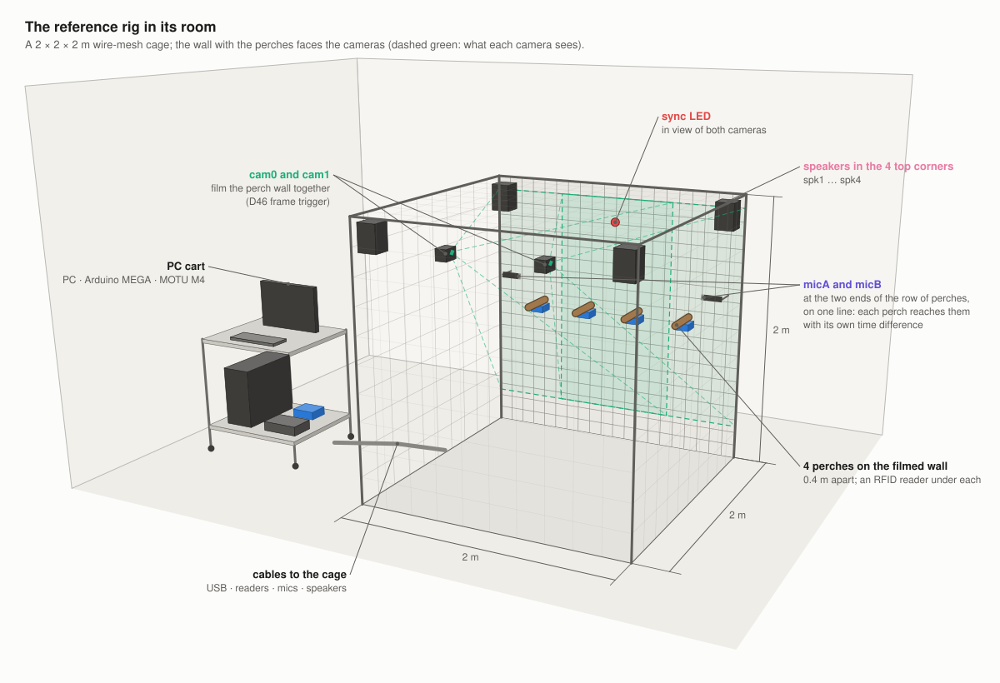
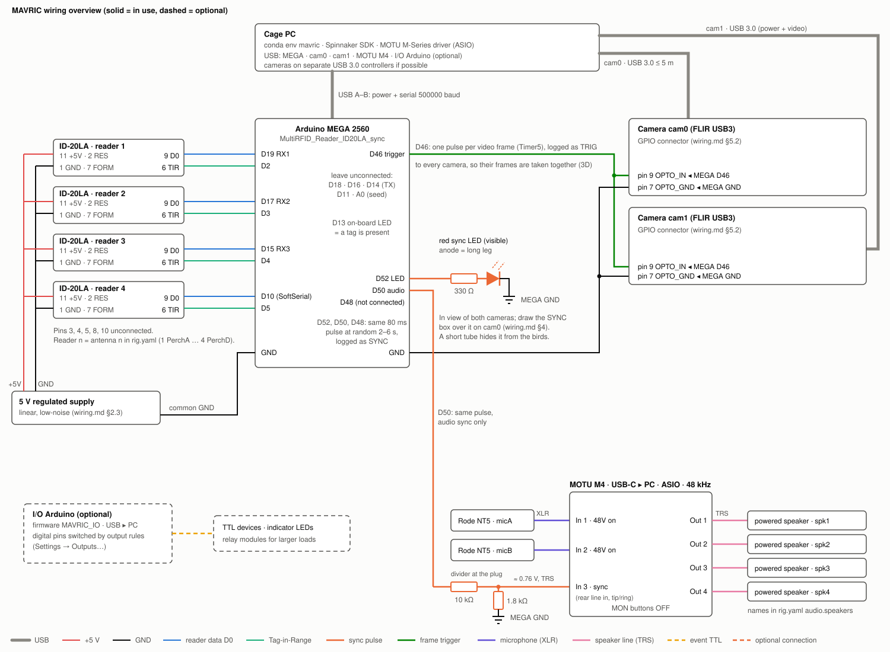

# MAVRIC hardware: wiring and pin maps

The technical hardware guide, written for the reference rig: pigeons on four RFID perches. Other rigs use the same
pins, cables and checks. Software setup and the device checks are in the [quick-use guide](quickstart.md#4-setting-up-the-devices);
drivers and firmware flashing in [installation.md](installation.md).



*The reference rig: a 2 × 2 × 2 m cage with the PC cart beside it. Both cameras film the wire-mesh wall that holds
the four perches. A microphone sits at each end of the row of perches, so a call from each perch reaches the two
microphones with its own time difference; a speaker hangs in each top corner.*



*The wiring: the readers, the MEGA, the red sync LED, both cameras on the D46 frame trigger, and the audio (MOTU M4,
two NT5, sync divider, four speakers). The I/O Arduino is optional.*

**What this covers:** what plugs in where: the PC, the Arduino MEGA, the four ID-20LA perch readers, the sync LED,
two FLIR USB3 cameras (or three) on the frame trigger, and the audio (MOTU M4, two Rode NT5, four speakers; §7).

**Required vs optional:** everything marked **required** is needed for a working rig. **Optional** connections only
add redundancy, or prepare later upgrades.

> **Safety first.** Wire with everything unplugged. Join all grounds before applying any signal, and check polarity
> before powering. The ID-20LA's absolute maximum is 5.5 V on its supply pin.

---

## 1. Overview: what connects to what

| From | To | Cable | Purpose | Status |
|---|---|---|---|---|
| PC USB 2/3 | Arduino MEGA USB-B | USB A–B | MEGA power + serial data (500000 baud) | **required** |
| PC USB 3.0 port | each camera's USB 3.0 port | USB 3.0, ≤ 5 m, screw-locking | camera power + video | **required** |
| 5 V regulated supply | the 4 ID-20LA readers (pins 11 and 2) | 2-wire per reader | reader power | **required** (bench: MEGA 5 V is acceptable) |
| ID-20LA pin 9 (D0) | MEGA D19 / D17 / D15 / D10 | signal + GND pair | tag ID data, 9600 baud | **required** |
| ID-20LA pin 6 (Tag in Range) | MEGA D2 / D3 / D4 / D5 | signal + GND pair | tag present | **required** |
| MEGA D52 | 330 Ω → red LED → GND; no resistor if the LED has one built in (§4.1) | 2-wire | sync LED, visible to the cameras | **required** |
| MEGA D46 + GND | each camera's GPIO pin 9 (OPTO_IN) + pin 7 (OPTO_GND) | 2-wire per camera | frame trigger: the cameras expose together (§5.3) | for 3D |
| PC USB | MOTU M4 USB-C | USB-C | audio interface (§7) | optional (audio) |
| Rode NT5 ×2 | M4 In 1, In 2 (48 V on) | XLR | microphones micA, micB | optional (audio) |
| MEGA D50 + GND, through a 10 kΩ / 1.8 kΩ divider | M4 In 3 | ¼" TRS: tip = signal, ring = GND | sync pulse into the audio | **required with audio** |
| M4 Out 1–4 | 4 powered speakers | balanced TRS | stimulus playback | optional (audio) |
| PC USB | **I/O Arduino** (`firmware/MAVRIC_IO`) | USB | event-driven TTL outputs (§6) | optional |

**Sync pins:** D52, D50 and D48 give the same pulse at the same moment (firmware `SYNC_PINS`):
- **D52:** the sync LED only.
- **D50:** the audio divider into M4 In 3.
- **D48:** not connected.

**Frame trigger:** D46 is a separate output: one pulse per video frame, to every camera (§5.3).

**Grounds:** every ground is common.
- **Joined together:** the MEGA GND, the reader supply GND and every reader's pin 1.
- **Cameras:** they share the PC's ground through USB. Their trigger input has its own ground, OPTO_GND (pin 7),
  which is joined to the MEGA GND together with the D46 wire.

---

## 2. RFID readers: ID-20LA (integrated antenna)

### 2.1 Module pin-map

The module is shown in **bottom view** and has a 2 mm pin pitch, which does not fit a breadboard. Pins 1–5 are on one
side and pins 6–10 on the other; pin 11 sits alone at the top. This follows the ID-Innovations datasheet
(ID-3LA/12LA/20LA, X2.01).

| Pin | Name | Connect to | Notes |
|---|---|---|---|
| 1 | GND (0 V) | common GND | supply and signal ground |
| 2 | RES (reset bar) | pin 11 (+5 V) | must be **strapped to pin 11 at all times** |
| 3 | ANT | — leave open | for the ID-3LA only; ID-20LA has the antenna inside |
| 4 | ANT | — leave open | as pin 3 |
| 5 | CP (card present) | — leave open | no function in ASCII mode |
| 6 | **Tag in Range** | **MEGA D2–D5** | high while a tag is in range, otherwise 0 V |
| 7 | Format selector | **GND** | GND selects **ASCII** (format is read at power-up) |
| 8 | D1 | — leave open | CMOS data with RS232 polarity (not used) |
| 9 | **D0** | **MEGA RX pin** | TTL ASCII data, 9600 8N1, for a UART RX pin |
| 10 | Read (beeper/LED) | optional: 1.5 kΩ → LED → GND | blinks while reading |
| 11 | +2.8 … +5.0 V | **+5 V supply** | low-noise supply (§2.3) |

### 2.2 Reader-to-MEGA map

The reader number is the antenna number in `config/rig.yaml → antennas`.

| Reader | Perch (rig.yaml) | Pin 9 (D0) → MEGA | Pin 6 (TIR) → MEGA | Power (pins 11 + 2) | Ground (pins 1 + 7) |
|---|---|---|---|---|---|
| 1 | PerchA | **D19** (RX1) | **D2** | +5 V | GND |
| 2 | PerchB | **D17** (RX2) | **D3** | +5 V | GND |
| 3 | PerchC | **D15** (RX3) | **D4** | +5 V | GND |
| 4 | PerchD | **D10** (SoftwareSerial RX) | **D5** | +5 V | GND |

After wiring, confirm which physical perch each reader serves:
1. Run `mavric link-test`.
2. Hold a tag on each perch in turn.
3. Correct the `antennas` names in `config/rig.yaml` if needed.

### 2.3 Power for the readers

**Bench:** the four readers may run from the MEGA's **5V** pin.

**In the cage (recommended):** use a separate **linear**, low-noise 5 V supply (a 7805-class regulator or a lab
supply). A switching supply can shorten the read range.
- **Wiring:** join its GND to the MEGA GND.
- **Do not** connect this supply's +5 V to the MEGA's 5V pin; the MEGA stays powered from USB.
- **At each module:** a decoupling capacitor across pins 11 and 1, as in the datasheet (§12).

### 2.4 Mounting under the perch

- **Keep metal away** from under and right next to the module (no copper plane, metal bracket or metal perch). It acts
  as a shorted turn and detunes the built-in antenna.
- **Keep wires out from under the module:** no supply wires or other electronics there.
- **Read range:** up to about 18 cm with an ISO card. The read zone with a pigeon leg ring is much smaller, so
  **measure it** on the bench at real perch heights and angles.
- **Crosstalk:** keep neighbouring perches far enough apart that a tag on one is never read by the other. Bench
  check: hold a tag on perch A and watch `mavric link-test` for reads at B.
- **Cable runs:** for runs to the MEGA (typically 1–3 m), use a twisted pair or shielded cable for each signal (D0 with
  GND, TIR with GND). 9600 baud TTL is robust over that length.

### 2.5 A reader that gives no readings

The module sends a tag's ID **once**, when the tag enters its field, and holds Tag in Range (TIR, pin 6) high until
it leaves. A multimeter on D0 (pin 9) always shows the idle level, close to the supply voltage (4.7–5 V from USB is
normal), because the ID takes only about 17 ms. So the multimeter can't tell whether an ID was sent; TIR is what
shows the reader's state. Work through these in order:

1. **Find out which reader it is.** Run `mavric link-test` and hold a tag on each place in turn. Each line ends with
   the reader number.
2. **Remove every tag, then measure TIR.** It must be 0 V with no tag near.
   - **TIR high with no tag:** the module believes a tag is in range, so it never sends a new one. Look for a stray
     tag within ~20 cm, e.g. a spare tag in or under the perch, or a tag box set down on the cage. Then power-cycle
     the reader supply, not only the MEGA: opening the serial port resets the MEGA, which then forgets the ID, but a
     tag that never left the field is never sent again.
   - **Still high after power-cycling, with nothing near:** check that pin 2 (RES) is strapped to +5 V and that pin
     11 has its supply. Then swap the module with a working one.
3. **TIR goes high only with a tag, but there is still no reading:** the ID is not reaching the MEGA.
   - **Pin 7 (format):** must be at GND **at power-up**. A loose pin 7 selects another output format, which the
     firmware can't parse.
   - **D0 wire:** check its continuity to the reader's RX pin in §2.2 (D19 / D17 / D15 / D10). Not the TX pin next
     to it (D18 / D16 / D14): that pin is driven by the MEGA and receives nothing.
   - **GND:** the reader's pin 1 and the supply GND must reach the MEGA GND. Check that the GND pins at the end of
     the double header (next to the sync pins) are still seated after any rewiring there.
4. **Swap test.** Swap this reader's D0 and TIR wires at the MEGA with a working reader's.
   - **The fault follows the reader:** it's the module, its board or its cable.
   - **The fault stays with the MEGA input:** it's that MEGA pin.

---

## 3. Arduino MEGA 2560: pin usage

This applies to the firmware `firmware/MultiRFID_Reader_ID20LA_sync`.

> **Changed 2026-10-27:** the sync pulse moved from D22 to **D52**, and **D50** gives the same pulse for the audio.
> Rigs wired earlier: with the firmware update, move the LED to D52 and the audio divider to D50.

| MEGA pin | Function in firmware | Connect to | Notes |
|---|---|---|---|
| USB-B | serial to PC, 500000 baud | PC | opening the port resets the board (that's normal) |
| GND | ground | common GND | readers, reader supply, sync LED, audio divider, the cameras' OPTO_GND |
| 5V | board 5 V | readers on the bench only | not in the cage (use the separate supply) |
| D2, D3, D4, D5 | Tag-in-Range inputs, readers 1–4 | ID-20LA pin 6 | the readers drive them; no pull-up needed. Optional 47 kΩ from each to GND: a broken TIR wire then reads "no tag" instead of a phantom subject |
| D19 (RX1), D17 (RX2), D15 (RX3) | reader 1–3 data in (9600) | ID-20LA pin 9 | hardware UARTs |
| D10 | reader 4 data in (SoftwareSerial RX) | ID-20LA pin 9 | pin supports pin-change interrupts |
| **D52** | **sync pulse out**: 80 ms HIGH at random 2–6 s intervals | the sync LED only: 330 Ω → red LED anode (§4.1) | each pulse is logged as `SYNC`. D52 sits at the GND end of the double header, beside the two GND pins |
| **D50** | **the same sync pulse** as D52 | 10 kΩ / 1.8 kΩ divider → M4 In 3 (§7.2) | audio only |
| **D48** | **the same sync pulse** as D52 | not connected | only ever connect inputs to D50 and D48, never another device's output |
| **D46** | **frame trigger out** (Timer5): a 1 ms pulse at the start of every frame | every camera's pin 9 OPTO_IN (§5.3) | off until Acquire connects the RFID reader (the PC sends `F<fps>`); each pulse is logged as `TRIG` |
| D13 | on-board LED: lit while any reader has a tag | — | visual check only |
| D18 (TX1), D16 (TX2), D14 (TX3), D11 (SoftSerial TX) | driven by the UARTs | **leave unconnected** | do not use as inputs |
| A0 | random seed for the sync intervals | **leave unconnected** | must float |
| D20–D45, D47, D49, D51, D53, other analog pins | free | — | |

---

## 4. Sync LED (required)

D52 drives a red LED and nothing else.

### 4.1 Red LED, straight from D52

**Circuit:** MEGA **D52 → 330 Ω → LED anode** (long leg), **LED cathode → GND**.
- A red LED sold as "5 V" has the resistor built in: wire it straight to D52 and GND.
- A bare LED, or one sold as "3 V", always needs the resistor. Straight on the pin it can damage the pin.
- The birds see a visible LED, so point it at the cameras through a short tube (§4.2).

**Checks**
1. Run `mavric link-test --port COM3`. The LED flashes once per `SYNC` line, every 2–6 s.
2. **Acquire GUI:** *Sync LED box brightness* jumps with each flash.
3. **5-minute recording,** then `mavric analyze`: the LED/SYNC check says **PASS**.

### 4.2 Placement and pulse length

**Placement**
- Put it in a corner of **every** camera's field of view, away from the perches.
- Point it at the camera through a short tube, so the pigeons see little of the flashes and reflections don't
  spread.
- In the acquire GUI, draw the **SYNC box** tightly over it. *Sync LED box brightness* must jump clearly with each
  flash (the analysis needs a contrast of more than about 20 grey levels).

**Pulse length vs frame rate:** the 80 ms pulse covers at least 2 frames down to 25 fps.
- **Slower camera** (below 25 fps, e.g. 13 fps): raise `SYNC_PULSE_US` in the firmware to ≥ 160 000, and set
  `sync.led_pulse_s: 0.16` in `rig.yaml` to match.
- `mavric camtest` and the recording warn if the pulse is too short.

---

## 5. Cameras

Two FLIR USB3 cameras (Chameleon3 in the reference rig) film the wall with the perches, both on the frame trigger
from D46. A third camera is wired the same way: its own USB 3.0 cable, its own D46 wire and its own GND to pin 7
(§5.3). Add it in Acquire with *Settings → Video settings… → Add camera…*, then calibrate it with the others.

### 5.1 Connections

- **USB 3.0** to the PC: a USB 3.0 port on the motherboard or on a PCIe 2.0 card, ideally one controller per camera.
  Screw-locking cable, ≤ 5 m. The camera is powered through USB.
- **Lens:** CS-mount; a C-mount lens needs the 5 mm adapter.
- **Mounting:** on a metal bracket; the camera runs warm.
- **GPIO:** pins 9 and 7 carry the frame trigger (§5.3). Nothing else is connected.

### 5.2 GPIO connector (9-pin, as seen from the rear)

**Connector:** JST **BM09B-NSHSS-TBT**. A pre-wired GPIO cable with the colours below is available from FLIR.

| Pin | Wire colour | Signal | Use in MAVRIC |
|---|---|---|---|
| 7 | brown | **OPTO_GND** | MEGA GND. **Connect this first.** |
| 9 | yellow | **OPTO_IN / Line0** | MEGA D46, the frame trigger |
| 8 | orange | OPTO_OUT / Line1 | not used (§5.4) |
| 1–6 | | power in, +3.3 V out, GPIO2/3, GND | leave open |

This is the Chameleon3's connector. Another camera has its own GPIO pin-map: wire D46 to its opto-isolated input and
the MEGA GND to that input's ground, and name the input in `trigger_line` if it is not Line0.

### 5.3 Frame trigger from D46 (pins 9 + 7)

Every camera on the trigger exposes on the same pulse, so their frames are taken together, which 3D tracking and pose
need. The RFID MEGA makes the pulses in hardware (Timer5), at the rate set in `rig.yaml`.

**Wiring** (each camera)
1. MEGA **GND → pin 7 (OPTO_GND)**, *before* the signal.
2. MEGA **D46 → pin 9 (OPTO_IN, Line0)**. Run one wire from D46 to each camera (a star, not a chain), and one GND
   to each pin 7.

**Why D46:** it is Timer5's output pin, so the timer itself switches it on the exact tick. A pin switched by the
program would wander by up to about 1 ms, because the reader software holds the processor that long.

**rig.yaml**
```yaml
sync:
  frame_trigger: {source: rfid, fps: 30}
cameras:
  - {id: cam0, backend: flir, frame_trigger: true, ...}
```
Or tick *Frame trigger (hardware)* per camera in *Settings → Video settings…*. The frame rate then comes from the
trigger. Keep each exposure shorter than one frame interval (Acquire warns).

**What happens**
- The MEGA sends the pulses from when Acquire connects the RFID reader until it disconnects (a board reset stops
  them; MAVRIC starts them again). A camera on the trigger sends no frames without pulses: the status line says it
  is waiting for the frame trigger.
- **Check:** with the RFID reader connected, each camera shows the trigger's frame rate, and the status line shows
  *frame trigger: running*. In SpinView, Line0's *LineStatus* flickers.
- If a camera misses pulses, check its pin 7 (OPTO_GND) wire, and that its exposure is shorter than one frame
  interval.

### 5.4 Future: exposure-active pulses (pin 8)

Pin 8 could report every exposure to the MEGA (on D21), for frame-exact sync without the LED. Not built: it needs a
firmware addition and a matching analysis step.

---

## 6. I/O Arduino: event-driven outputs

A second, **dedicated** Arduino (Uno, Nano, Nano Every or MEGA) runs `firmware/MAVRIC_IO`. MAVRIC switches its pins
when output rules fire (acquire GUI → **Settings → Outputs…**). The RFID MEGA is left untouched.

### 6.1 Board

| Item | Connect to | Notes |
|---|---|---|
| USB | PC (any USB port) | 115200 baud. Find the COM port with `mavric ports`, and set it in the device (Outputs… → Devices). |
| Firmware | `firmware/MAVRIC_IO/MAVRIC_IO.ino` | `arduino-cli compile --fqbn arduino:avr:uno firmware/MAVRIC_IO`, then `upload -p COMx` |
| Output pins | any digital pin **except 0 and 1** (USB serial) | 5 V high / 0 V low, for small loads; anything bigger goes through a relay module (§6.2) |
| GND | common with every device it drives | |

**Watchdog.** If the PC stops talking for longer than `watchdog_s` (default 2 s), the board switches every pin low on
its own, which also covers a crash or a pulled USB cable. Disarming, closing the app and saving the Outputs menu also
switch all pins low.

**Intan:** not wired in this rig.

### 6.2 LEDs and relays

| Load | Circuit | Notes |
|---|---|---|
| Small indicator LED | pin → 330 Ω → LED → GND | direct |
| Lights, mains or other larger loads | a **relay module** with its own driver and flyback diode, "high-level trigger" type (MAVRIC's on = HIGH) | only with a certified module and enclosure; keep mains away from the cage and the animals |

### 6.3 Checks

1. **Board answers:** `mavric outputs test io` reports `MAVRIC_IO 1.0 …`.
2. **Each rule works:** `mavric outputs fire <rule>` runs it once. A *hold* rule switches on, then off after 1 s.
   Watch it on the LED or a multimeter.
3. **Watchdog:** with a hold active, unplug the board's USB. The output must drop within about 2 s.

---

## 7. Audio: MOTU M4, two Rode NT5, sync pulse, four speakers

### 7.1 Connections

| From | To | Cable | Notes |
|---|---|---|---|
| MOTU M4 USB-C | PC USB | USB-C | Power and audio. Install the MOTU M-Series driver: MAVRIC uses its ASIO driver. |
| NT5 "micA" | M4 **In 1** (front combo jack) | XLR, balanced | Press **48V** for input 1: the NT5 needs phantom power. |
| NT5 "micB" | M4 **In 2** | XLR, balanced | Press **48V** for input 2. |
| RFID MEGA **D50** + GND, through the divider below | M4 **In 3** (rear line input) | two-core cable, ¼" TRS plug: tip = signal, ring = GND (§7.2) | Records the sync pulse. D50 has the same pulse as the LED on D52 and feeds only this. |
| M4 **Out 1–4** (rear, balanced ¼" TRS) | powered speakers spk1–spk4 | TRS–XLR or TRS–TRS, balanced | Match `audio.speakers` in `rig.yaml`. The RCA outputs mirror Out 1–4. |

**M4 front panel**
- **MON buttons (direct monitoring):** switch them **off**. With MON on, an input is sent straight to Out 1–2, so the
  mics would play through spk1/spk2 (feedback) and the sync pulse would click on them.
- **Big knob (main volume):** users report that it sets the level of Out 1–2, while Out 3–4 stay at a fixed line
  level. Mark its position and check the speaker levels with `mavric audio test --tones`, so stimulus levels stay
  the same between sessions.

### 7.2 Sync cable: D50 → M4 In 3

The D50 pulse is 5 V, which is too large for a line input. A resistor divider brings it to about 0.76 V:

```
MEGA D50 ──[ 10 kΩ ]──┬──────── TRS tip    → M4 In 3
                      │
                  [ 1.8 kΩ ]
                      │
MEGA GND ─────────────┴──────── TRS ring   (sleeve: unconnected, or the cable shield)
```

- **Where:** put the two resistors in the plug or at the MEGA end.
- **TRS plug:** In 3 is a balanced input that records tip minus ring. So the signal goes to the tip and MEGA GND
  to the ring (the middle segment). The sleeve stays unconnected, or takes only the cable shield.
  - Swapped wires only invert the pulse: MAVRIC detects the polarity, and `mavric audio test` prints "inverted".
  - A TS plug also works: signal on the tip, GND on the sleeve.
- **Ground:** the MEGA and the M4 already share ground through the PC's USB.
- **Line input:** In 3 is AC-coupled. The recording shows a sharp step at each pulse edge with a sag in between,
  which is what MAVRIC detects.
- **Level:** `mavric audio test` reports the step level. Anything between about −35 and −6 dBFS works. If the step
  clips, use 22 kΩ instead of 10 kΩ; if it is below −40 dBFS, use 4.7 kΩ.

### 7.3 Checks

1. **Device found:** `mavric audio devices` marks the M4 as `<- configured`. If it doesn't, check the driver and
   `audio.device` / `audio.host_api` in `rig.yaml`.
2. **Bench test:** `mavric audio test`, with the RFID Arduino running.
   - micA and micB show signal (speak or clap). Neither clips.
   - The sync check reports ~80 ms pulses every 2–6 s.
   - There are no input overflows.
3. **Speakers:** `mavric audio test --tones`. Each speaker's tone is heard on its nearer microphone, with a delay of a
   few tens of ms. Keep the animals out of the room, or keep `--tone-db` low (default −30 dBFS).
   - **Round trip:** the test prints the driver's round trip. The rest of each delay is the air, about 2.9 ms per
     metre from speaker to microphone.
   - **One speaker by ear:** `mavric audio play test_tone --speaker spk1 --gain-db -10`.
   - **Before the speakers are connected:** the M4's headphone output carries Out 1–2 (spk1, spk2), not Out 3–4.
4. **Synchronization:** make a 5-minute recording in `mavric acquire` (Connect audio), then run `mavric analyze`. The
   audio line must say **PASS**.

---

## 8. Bring-up order and checks

1. **Readers on the bench.** Power them (MEGA 5 V is fine at this stage). A tag on a reader should light D13 on the MEGA.
2. **Flash the firmware** and run `mavric link-test --port COMx`.
   - Every reader reports its tags, and every TIR works (if no tag is ever reported, the TIR wire is missing).
   - `SYNC` lines appear every 2–6 s.
3. **Sync LED:** it flashes in step with the `SYNC` lines.
4. **Camera:**
   - SpinView streams.
   - `mavric ports` lists the camera.
   - `mavric camtest --cam cam0` shows no drops, the measured fps equals the configured fps, and there are no warnings.
5. **Frame trigger:** wire D46 and GND to each camera (§5.3). With the RFID reader connected in Acquire, every
   camera runs at the trigger's rate.
6. **Acquire GUI:**
   - Draw the 4 perch ROIs and the SYNC box. Each ROI lights up when you hold a tag on its perch.
   - The SYNC box brightness jumps with each flash.
7. **5-minute test recording,** then `mavric analyze`: the LED/SYNC check must say **PASS**.
8. **Audio** (if used): run the checks in §7.3.
9. **Move to the cage** and switch the readers to the linear supply. Repeat steps 2, 6, 7 and 8.

---

## Sources

- [ID-Innovations ID-3LA / ID-12LA / ID-20LA datasheet (X2.01)](https://cdn.sparkfun.com/assets/c/7/0/e/3/DS-11828-RFID_Reader_ID-20LA__125_kHz_.pdf)
  - §2 pin-out, §3 operating characteristics, §6 pin description, §7 absolute maximum ratings, §12 power supply,
    §17 layout precautions.
- [Point Grey Chameleon3 Technical Reference v3.0 (2015)](https://www.teledynevisionsolutions.com/products/chameleon3-usb3/) (product page → Resources → CM3-U3 Technical Reference)
  - §4.5 lens mount, §4.8 connectors and GPIO pin-map, §6 I/O control.
- [Trinamic TMCM-1141 (Analog Devices)](https://www.analog.com/en/products/tmcm-1141.html) (product page → hardware and TMCL firmware manuals)
  - for a possible stepper-motor output (not built yet).
- MultiRFID `Arduino Software/README.md` (reader-to-MEGA wiring), and the MAVRIC firmware
  `firmware/MultiRFID_Reader_ID20LA_sync`.
