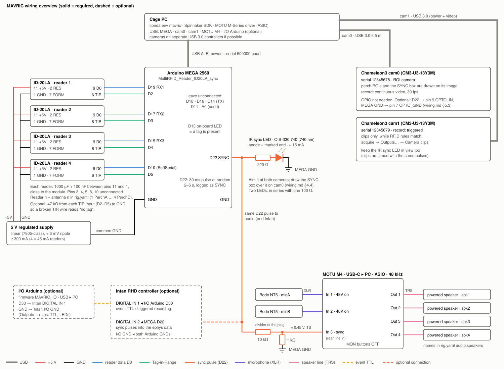

# MAVRIC hardware: wiring and pin maps

The technical hardware guide, written for the reference rig: pigeons on four RFID perches. Other rigs use the same
pins, cables and checks. Software setup and the device checks are in the [quick-use guide](quickstart.md#4-setting-up-the-devices);
drivers and firmware flashing in [installation.md](installation.md).



*The diagram shows the readers, the MEGA, the red sync LED, cam0 (ROIs, continuous) and cam1 (clips only), and the audio (MOTU M4, two NT5, sync divider, four speakers). The I/O Arduino and Intan are optional.*

**What this covers:** what plugs in where: the PC, the Arduino MEGA, the four ID-20LA perch readers, the sync LED,
two Point Grey Chameleon3 cameras (cam0 with the ROIs, cam1 for triggered clips), and the audio (MOTU M4, two Rode NT5,
four speakers; §7).

**Required vs optional:** everything marked **required** is needed for a working rig. **Optional** connections only
add redundancy, or prepare later upgrades.

> **Safety first.** Wire with everything unplugged. Join all grounds before applying any signal, and check polarity
> before powering. The ID-20LA's absolute maximum is 5.5 V on its supply pin.

---

## 1. Overview: what connects to what

| From | To | Cable | Purpose | Status |
|---|---|---|---|---|
| PC USB 2/3 | Arduino MEGA USB-B | USB A–B | MEGA power + serial data (500000 baud) | **required** |
| PC USB 3.0 port (PCIe 2.0 controller) | Chameleon3 USB 3.0 Micro-B | USB 3.0 Micro-B, ≤ 5 m (≤ 3 m preferred), screw-locking | camera power + video | **required** |
| 5 V regulated supply | the 4 ID-20LA readers (pins 11 and 2) | 2-wire per reader | reader power | **required** (bench: MEGA 5 V is acceptable) |
| ID-20LA pin 9 (D0) | MEGA D19 / D17 / D15 / D10 | signal + GND pair | tag ID data, 9600 baud | **required** |
| ID-20LA pin 6 (Tag in Range) | MEGA D2 / D3 / D4 / D5 | signal + GND pair | tag present | **required** |
| MEGA D52 | 330 Ω → red LED → GND; no resistor if the LED has one built in (§4.1) | 2-wire | sync LED, visible to the cameras | **required** |
| MEGA D48 + GND | Chameleon3 GPIO pin 9 (OPTO_IN) + pin 7 (OPTO_GND) | 2-wire | sync pulse into the camera | optional |
| Chameleon3 GPIO pin 8 (OPTO_OUT) | MEGA D21 (4.7 kΩ pull-up to 5 V) | 2-wire | exposure-active pulses to the Arduino | future (needs a firmware change) |
| PC USB | **I/O Arduino** (`firmware/MAVRIC_IO`) | USB | event-driven TTL outputs (§6) | optional |
| I/O Arduino pin + GND | Intan DIGITAL IN 1 + I/O GND | BNC coax | event TTL / triggered recording | optional |
| MEGA D48 + GND | Intan DIGITAL IN 2 + I/O GND | BNC coax | sync pulses into the ephys data | optional (recommended with Intan) |
| PC USB | MOTU M4 USB-C | USB-C | audio interface (§7) | optional (audio) |
| Rode NT5 ×2 | M4 In 1, In 2 (48 V on) | XLR | microphones micA, micB | optional (audio) |
| MEGA D50 + GND, through a 10 kΩ / 1.8 kΩ divider | M4 In 3 | ¼" TRS: tip = signal, ring = GND | sync pulse into the audio | **required with audio** |
| M4 Out 1–4 | 4 powered speakers | balanced TRS | stimulus playback | optional (audio) |

**Sync pins:** D52, D50 and D48 give the same pulse at the same moment (firmware `SYNC_PINS`), each to its own load:
- **D52:** the sync LED only.
- **D50:** the audio divider into M4 In 3.
- **D48:** spare, with nothing connected yet. It is ready for the camera opto input or Intan DIGITAL IN 2, which
  can share it.

**Grounds:** every ground is common, except the camera's isolated OPTO_GND.
- **Joined together:** the MEGA GND, the reader supply GND and every reader's pin 1.
- **Camera:** it shares the PC's ground through USB. OPTO_GND (pin 7) is isolated and is only joined to the MEGA
  GND if you use the optional opto connection.

---

## 2. RFID readers: ID-20LA (integrated antenna)

### 2.1 Module pin-map

The module is shown in **bottom view** and has a 2 mm pin pitch, which does not fit a breadboard. Pins 1–5 are on one
side and pins 6–10 on the other; pin 11 sits alone at the top. This follows the ID-Innovations datasheet
(ID-3LA/12LA/20LA, X2.01).

| Pin | Name | Connect to | Notes |
|---|---|---|---|
| 1 | GND (0 V) | common GND | supply and signal ground |
| 2 | RES (reset bar) | pin 11 (+5 V) | must be **strapped to pin 11 at all times** |
| 3 | ANT | — leave open | for the ID-3LA only; ID-20LA has the antenna inside |
| 4 | ANT | — leave open | as pin 3 |
| 5 | CP (card present) | — leave open | no function in ASCII mode |
| 6 | **Tag in Range** | **MEGA D2–D5** | goes to VDD while a tag is in range, otherwise 0 V; internal 3K3; max 5 mA |
| 7 | Format selector | **GND** | GND selects **ASCII** (format is read at power-up) |
| 8 | D1 | — leave open | CMOS data with RS232 polarity (not used) |
| 9 | **D0** | **MEGA RX pin** | TTL ASCII data, 9600 8N1, for a UART RX pin |
| 10 | Read (beeper/LED) | optional: 1.5 kΩ → LED → GND | 3.1 kHz square wave while reading; max 10 mA |
| 11 | +2.8 … +5.0 V | **+5 V supply** | about 45 mA per ID-20LA; low-noise supply |

### 2.2 Reader-to-MEGA map

The reader number is the antenna number in `config/rig.yaml → antennas`.

| Reader | Perch (rig.yaml) | Pin 9 (D0) → MEGA | Pin 6 (TIR) → MEGA | Power (pins 11 + 2) | Ground (pins 1 + 7) |
|---|---|---|---|---|---|
| 1 | PerchA | **D19** (RX1) | **D2** | +5 V | GND |
| 2 | PerchB | **D17** (RX2) | **D3** | +5 V | GND |
| 3 | PerchC | **D15** (RX3) | **D4** | +5 V | GND |
| 4 | PerchD | **D10** (SoftwareSerial RX) | **D5** | +5 V | GND |

After wiring, confirm which physical perch each reader serves:
1. Run `mavric link-test`.
2. Hold a tag on each perch in turn.
3. Correct the `antennas` names in `config/rig.yaml` if needed.

### 2.3 Power for the readers

**Bench:** the four readers may run from the MEGA's **5V** pin (4 × 45 mA ≈ 180 mA from USB).

**In the cage (recommended):** use a separate **linear** 5 V supply.
- **Supply:** a 7805-class regulator or a lab supply, with ripple below **3 mV peak-to-peak**.
- **Why:** the datasheet warns that switching supplies near multiples of 125 kHz cut the read range.
- **Wiring:** join its GND to the MEGA GND.
- **Do not** connect this supply's +5 V to the MEGA's 5V pin; the MEGA stays powered from USB.

**Decoupling:** at each module, fit **1000 µF + 100 nF** between pins 11 and 1, as close to the pins as possible.

### 2.4 Mounting under the perch

- **Keep metal away** from under and right next to the module (no copper plane, metal bracket or metal perch). It acts
  as a shorted turn and detunes the built-in antenna.
- **Keep wires out from under the module:** no supply wires or other electronics there.
- **Read range:** up to about 18 cm with an ISO card. The read zone with a pigeon leg ring is much smaller, so
  **measure it** on the bench at real perch heights and angles.
- **Crosstalk:** keep neighbouring perches far enough apart that a tag on one is never read by the other. Bench
  check: hold a tag on perch A and watch `mavric link-test` for reads at B.
- **Cable runs:** for runs to the MEGA (typically 1–3 m), use a twisted pair or shielded cable for each signal (D0 with
  GND, TIR with GND). 9600 baud TTL is robust over that length.

### 2.5 A reader that gives no readings

The module sends a tag's ID **once**, when the tag enters its field, and holds Tag in Range (TIR, pin 6) high until
it leaves. A multimeter on D0 (pin 9) always shows the idle level, close to the supply voltage (4.7–5 V from USB is
normal), because the ID takes only about 17 ms. So the multimeter can't tell whether an ID was sent; TIR is what
shows the reader's state. Work through these in order:

1. **Find out which reader it is.** Run `mavric link-test` and hold a tag on each place in turn. Each line ends with
   the reader number.
2. **Remove every tag, then measure TIR.** It must be 0 V with no tag near.
   - **TIR high with no tag:** the module believes a tag is in range, so it never sends a new one. Look for a stray
     tag within ~20 cm, e.g. a spare tag in or under the perch, or a tag box set down on the cage. Then power-cycle
     the reader supply, not only the MEGA: opening the serial port resets the MEGA, which then forgets the ID, but a
     tag that never left the field is never sent again.
   - **Still high after power-cycling, with nothing near:** check that pin 2 (RES) is strapped to +5 V and that pin
     11 has its supply. Then swap the module with a working one.
3. **TIR goes high only with a tag, but there is still no reading:** the ID is not reaching the MEGA.
   - **Pin 7 (format):** must be at GND **at power-up**. A loose pin 7 selects another output format, which the
     firmware can't parse.
   - **D0 wire:** check its continuity to the reader's RX pin in §2.2 (D19 / D17 / D15 / D10). Not the TX pin next
     to it (D18 / D16 / D14): that pin is driven by the MEGA and receives nothing.
   - **GND:** the reader's pin 1 and the supply GND must reach the MEGA GND. Check that the GND pins at the end of
     the double header (next to the sync pins) are still seated after any rewiring there.
4. **Swap test.** Swap this reader's D0 and TIR wires at the MEGA with a working reader's.
   - **The fault follows the reader:** it's the module, its board or its cable.
   - **The fault stays with the MEGA input:** it's that MEGA pin.

---

## 3. Arduino MEGA 2560: pin usage

This applies to the firmware `firmware/MultiRFID_Reader_ID20LA_sync`.

> **Changed 2026-10-27:** the sync pulse moved from D22 to **D52**, and **D50** and **D48** now give the same pulse.
> Rigs wired earlier: move the sync wires from D22 together with the firmware update: the LED to D52, the audio
> divider to D50, and the camera opto input and Intan to D48.

| MEGA pin | Function in firmware | Connect to | Notes |
|---|---|---|---|
| USB-B | serial to PC, 500000 baud | PC | opening the port resets the board (that's normal) |
| GND | ground | common GND | readers, reader supply, sync LED, audio divider; optional camera OPTO_GND and Intan I/O GND |
| 5V | board 5 V | readers on the bench only | not in the cage (use the separate supply) |
| D2, D3, D4, D5 | Tag-in-Range inputs, readers 1–4 | ID-20LA pin 6 | the readers drive them; no pull-up needed. Optional 47 kΩ from each to GND: a broken TIR wire then reads "no tag" instead of a phantom subject |
| D19 (RX1), D17 (RX2), D15 (RX3) | reader 1–3 data in (9600) | ID-20LA pin 9 | hardware UARTs |
| D10 | reader 4 data in (SoftwareSerial RX) | ID-20LA pin 9 | pin supports pin-change interrupts |
| **D52** | **sync pulse out**: 80 ms HIGH at random 2–6 s intervals | the sync LED only: 330 Ω → red LED anode (§4.1) | each pulse is logged as `SYNC`. D52 sits at the GND end of the double header, beside the two GND pins. It is also the SPI clock (SCK), which is unused here |
| **D50** | **the same sync pulse** as D52 | 10 kΩ / 1.8 kΩ divider → M4 In 3 (§7.2) | switches within ~10 µs of D52, less than one audio sample |
| **D48** | **the same sync pulse** as D52 | spare: nothing connected yet. For camera pin 9 (§5.3) and Intan DIGITAL IN 2 (§6.2) | switches within ~10 µs of D52, less than one Intan sample. Only connect inputs to D50 and D48, never another device's output |
| D13 | on-board LED: lit while any reader has a tag | — | visual check only |
| D18 (TX1), D16 (TX2), D14 (TX3), D11 (SoftSerial TX) | driven by the UARTs | **leave unconnected** | do not use as inputs |
| A0 | random seed for the sync intervals | **leave unconnected** | must float |
| **D46** | **frame trigger out** (Timer5): a 1 ms pulse at the start of every frame, while the PC asks for it | every frame-triggered camera's trigger input (§5.5) | optional, for frame-locked cameras (3D). Off until the PC sends `F<fps>` (`sync: frame_trigger: source: rfid`); pulses logged as `TRIG` lines |
| D20, D21 | free, interrupt-capable | — | reserved for the future camera exposure-active input |
| D22–D47, D49, D51, D53, other analog pins | free | — | |

---

## 4. Sync LED (required)

D52 drives the LED and nothing else.
- **§4.1:** a visible red LED, the one the rig uses.
- **§4.2:** an alternative the birds barely see: an infrared (740 nm) SMD LED, OIS-330 740, through 220 Ω.

The firmware, the timing and the analysis are identical for both.

### 4.1 Red LED, straight from D52 (in use)

**Circuit:** MEGA **D52 → 330 Ω → LED anode**, **LED cathode → GND**.
- With a red LED (Vf ≈ 2 V) this draws about 9 mA. That's within the ATmega2560's recommended 20 mA per pin.
- A red LED sold as "5 V" has the resistor built in: wire it straight to D52 and GND (table below).
- The birds see a visible LED, so point it at the camera through a short tube (§4.3).

**Buying LEDs for D52.** The pin outputs 5 V. Keep the LED current at **15 mA or less**.

| LED sold as | Wiring | Notes |
|---|---|---|
| **"5 V", with built-in resistor** (pre-wired) | D52 → LED + (red), LED − → GND | **Recommended:** nothing to add. Check that the listed current is ≤ 15 mA. |
| **"3 V"**, or a bare LED (no resistor) | D52 → **resistor** → LED + (anode, long leg), LED − → GND | Needs the resistor. White/blue (≈ 3 V): **220 Ω** (≈ 9 mA). Red/yellow (≈ 2 V): **330 Ω** (≈ 9 mA). |

**Never connect a bare or "3 V" LED straight to the pin.** Nothing would then limit the current except the pin
itself, which can exceed the pin's 40 mA absolute maximum and damage it.

**Checks**
1. Run `mavric link-test --port COM3`. The LED flashes once per `SYNC` line, every 2–6 s.
2. **Acquire GUI:** *Sync LED box brightness* jumps with each flash.
3. **5-minute recording,** then `mavric analyze`: the LED/SYNC check says **PASS**.

### 4.2 Alternative: infrared sync LED, EPIGAP OSA OIS-330 740

Datasheet: [OIS-330 740](https://www.epigap-osa.com/datasheet/OIS-330_740.pdf) ([product page](https://www.epigap-osa.com/product/ois-330-740/)).

| Property | Value (datasheet) | What it means here |
|---|---|---|
| Wavelength | 740 nm peak (730–750 nm), 25 nm wide | far red, at the edge of visible light |
| Forward voltage | 1.7 V typical, 2.0 V maximum, at 30 mA | sets the resistor |
| Maximum current | **30 mA** continuous (less above 60 °C) | run it at about 15 mA. The 150 mA pulse rating is for pulses ≤ 100 µs, so it does not apply to 80 ms sync pulses. |
| Reverse voltage | 5 V maximum | D52 never reverses it |
| Beam | 40° (built-in lens) | aim it at the camera |
| Package | 1206 SMD, 3.2 × 1.6 × 1.9 mm; the **mark on the back is the anode** | needs soldering (below) |

**Circuit: one LED**

```
MEGA D52 ──[ 220 Ω ]──► anode (marked end)  OIS-330 740  cathode ──── MEGA GND
```

- **Current:** (5 V − 1.7 V) / 220 Ω ≈ 15 mA. The pin sags slightly under load, so expect 13–15 mA.
- **Headroom:** that is half the LED's maximum.
- **Brighter:** 180 Ω (≈ 18 mA) is the most to draw from D52. Never use less than 150 Ω.

**Circuit: two LEDs** (e.g. one in view of each camera): put them **in series** with one 100 Ω resistor.

```
MEGA D52 ──[ 100 Ω ]──► LED 1 ──► LED 2 ──── MEGA GND        (each LED: anode towards D52)
```

- **Current:** (5 − 2 × 1.7) / 100 ≈ 16 mA through both, and still ≈ 10 mA with worst-case 2.0 V LEDs.
- **Not in parallel:** don't put them in parallel on one resistor (they share current unevenly). Two separate 220 Ω
  branches would take 30 mA from the pin.

**Soldering the 1206 package**
- **Wires:** solder two thin stranded wires (e.g. 0.14 mm²) to the end pads. Or mount the LED on a 1206 adapter
  board or a scrap of perfboard.
- **Iron:** 25 W at most, 300 °C, ≤ 3 s per pad (datasheet).
- **Insulation:** cover the joints with heat-shrink, leaving the lens free.
- **Static:** the LEDs ship in ESD bags. Touch ground before handling them.

**Polarity check** (before wiring it in): use a multimeter in diode mode.
- **Red probe on the anode (marked end):** about 1.4–1.6 V, and a faint glow that a phone camera shows clearly.
- **Reversed:** it reads "OL".

**Will the camera see it?**
- **Camera body:** Chameleon3 **mono** models have plain glass where colour models have an IR-cut filter (Chameleon3
  manual §4.7). Their P1300 sensor still responds at 740 nm.
- **Lens:** some lenses carry an IR-blocking coating. Check in the acquire GUI: *Sync LED box brightness* must jump
  by more than about 20 grey levels at the recording exposure.
- **If the jump is too weak:** aim the LED straight at the lens, move it closer, use 180 Ω, or add a second LED in
  series.

**Will the birds see it?** 740 nm is far red, not deep infrared.
- **People:** looking straight into it, people see a dim, dark red glow.
- **Pigeons:** their sensitivity at this end of the spectrum is probably similar, so expect them to see it faintly.
  That is still far less conspicuous than a visible LED, especially aimed at the camera through the short tube (§4.3).
- **To make it fully invisible to the birds:** use 850 nm or 940 nm LEDs with the same circuit (R ≈ (5 − Vf) / 15 mA).
  The camera is less sensitive there, so test one first.

**Checks**
1. Run `mavric link-test --port COM3`. The LED pulses every 2–6 s; a phone camera shows the flashes.
2. **Acquire GUI:** the SYNC box brightness jumps with each flash.
3. **5-minute recording,** then `mavric analyze`: the LED/SYNC check says **PASS**.

### 4.3 Placement and pulse length (both versions)

**Placement**
- Put it in a corner of **every** camera's field of view, away from the perches.
- Point it at the camera through a short tube, so the pigeons see little of the flashes and reflections don't
  spread.
- In the acquire GUI, draw the **SYNC box** tightly over it. *Sync LED box brightness* must jump clearly with each
  flash (the analysis needs a contrast of more than about 20 grey levels).

**Pulse length vs frame rate:** the 80 ms pulse covers at least 2 frames down to 25 fps.
- **Slower camera** (e.g. a Chameleon3 CM3-U3-28S4 at 13 fps): raise `SYNC_PULSE_US` in the firmware to ≥ 160 000, and
  set `sync.led_pulse_s: 0.16` in `rig.yaml` to match.
- `mavric camtest` and the recording warn if the pulse is too short.

---

## 5. Camera: Point Grey Chameleon3 (CM3-U3)

### 5.1 Required connections

- **USB 3.0 Micro-B** to the PC. Use a **USB 3.0 port on a PCIe 2.0 controller** or the motherboard.
  - PCIe 1.0 cards are limited to about 180 MB/s.
  - Use the screw-locking cable, ≤ 5 m long; not 5 m on laptops.
  - The camera is powered through USB (5 V, < 3 W).
- **Lens:** CS-mount; a C-mount lens needs the 5 mm adapter. Not included with the camera.
- **Mounting:** M2/M3 holes, or the tripod adapter (¼-20). Mount it on a metal bracket for heat; the camera runs warm.
- **Nothing on the GPIO connector is needed** for MAVRIC with the Chameleon3. Sync uses the LED seen in the image.

### 5.2 GPIO connector pin-map (9-pin, as seen from the rear)

**Connector parts:** header JST **BM09B-NSHSS-TBT**; mating plug **NSHR-09V-S** with **SSHL-003T-P0.2** crimp
contacts. A pre-wired GPIO cable with the colours below is available from Point Grey / FLIR.

| Pin | Wire colour | Signal | Electrical | Use in MAVRIC |
|---|---|---|---|---|
| 1 | red | V_EXT power in | 5–24 V DC | **not used** (USB power). Only if USB power is insufficient (long cable). |
| 2 | black | GND | for V_EXT, +3.3 V, GPIO2/3 | not used |
| 3 | white | +3.3 V out | 150 mA max, fused | **leave open** |
| 4 | green | GPIO3 / Line3 | bidirectional, non-isolated, 0–24 V | leave open |
| 5 | purple | GPIO2 / Line2 | bidirectional, non-isolated, 0–24 V | leave open |
| 6 | black | GND | as pin 2 | not used |
| 7 | brown | **OPTO_GND** | ground of the isolated I/O | **optional:** MEGA GND. **Connect this first.** |
| 8 | orange | **OPTO_OUT / Line1** | opto-isolated, open collector: needs a pull-up, ≤ 24 V, ≤ 25 mA | **future:** exposure-active strobe → MEGA D21 with a 4.7 kΩ pull-up to MEGA 5 V |
| 9 | yellow | **OPTO_IN / Line0** | opto-isolated input, 0–30 V (abs. max 40 V) | **optional:** MEGA D48 (the sync pulse) |

The opto-isolated limits apply when the camera is powered over USB (manual §6.5).

### 5.3 Optional: sync pulse into the camera (pins 9 + 7)

**Wiring**
1. MEGA **GND → pin 7 (OPTO_GND)**, *before* any signal.
2. MEGA **D48 → pin 9 (OPTO_IN)**. D48 is the spare sync output, with the same pulse as the LED on D52.

**Check:** in **SpinView**, set Line0 to *Input* and watch *LineStatus* flip on each flash.
- If it never goes high, the 5 V pulse may not drive the opto input hard enough. Buffer it, for example with a
  transistor switching 12 V. The 2015 manual gives no input threshold or current.

**What it gives today:** a wiring check only. The Chameleon3 cannot store the line state per frame: its GenICam chunks
are image CRC, frame counter, offsets, size, exposure, gain and black level. So `line_status: false` stays in
`rig.yaml`.
- The pin becomes useful with a camera that has a line-status chunk: Basler `LineStatusAll`, or FLIR Blackfly S
  models with `ExposureEndLineStatusAll` (not the BFS-U3-16S2, whose chunks have no line state).
- With the frame trigger (§5.5), the opto input takes the trigger instead.

### 5.5 Optional: frame trigger for 3D (pins 9 + 7)

Every frame-triggered camera exposes on the same pulse, so their frames are taken together: what 3D tracking and pose
need. The RFID MEGA makes the pulses in hardware (Timer5), at the rate set in `rig.yaml`.
- **Why D46:** it is Timer5's output pin, so the timer itself switches it on the exact tick. Other pins, such as
  the spare D48, can only be switched by the program, and the reader software holds the processor for up to about
  1 ms at a time, so their edges would wander.

**Wiring** (each camera)
1. MEGA **GND → pin 7 (OPTO_GND)**, *before* any signal.
2. MEGA **D46 → pin 9 (OPTO_IN, Line0)**. With several cameras, run one wire from D46 to each camera's pin 9 (a star,
   not a chain), and one GND to each pin 7.
- **Blackfly S:** its opto-isolated input is Line0 too; the pin numbers are in the camera's reference (GPIO).
- **Basler ace:** the opto-isolated input is Line1 (`trigger_line: Line1` is the default for `basler`).
- The opto input now carries the trigger, so the sync pulse from D48 (§5.3) cannot go there as well. The sync LED in
  the image still checks the timing.

**rig.yaml**
```yaml
sync:
  frame_trigger: {source: rfid, fps: 30}
cameras:
  - {id: cam0, backend: flir, frame_trigger: true, ...}
```
Or tick *Frame trigger (hardware)* per camera in *Video settings…*. The frame rate then comes from the trigger.
Keep each exposure shorter than one frame interval (Acquire warns).

**What happens**
- The MEGA sends the pulses from when Acquire connects the RFID reader until it disconnects (a board reset stops
  them; MAVRIC starts them again). A frame-triggered camera without pulses sends no frames: the status line says it
  is waiting for the frame trigger.
- **Check:** with the RFID reader connected, each frame-triggered camera shows the trigger's frame rate, and the
  status line shows *frame trigger: running*. In SpinView, Line0's *LineStatus* flickers.
- If a camera misses pulses, the MEGA pin may not drive the opto inputs hard enough. Buffer it, for example with one
  transistor per camera switching 5–12 V. The 2015 manual gives no input threshold or current.

### 5.4 Future: exposure-active pulses to the Arduino (pins 8 + 7)

This would log every exposure start on the Arduino clock, giving frame-exact video↔RFID sync with no image analysis.

**Wiring**
1. Pin **7 (OPTO_GND) → MEGA GND**.
2. Pin **8 (OPTO_OUT) → MEGA D21**, with a **4.7 kΩ pull-up from D21 to MEGA 5V** (about 1 mA, well under 25 mA).

**Camera setting:** set Line1 to *Strobe* (exposure active). The open-collector output pulls low while active; use
*LineInverter* if needed.

**Not implemented yet:** this needs a firmware addition (log `FRAME` lines from an interrupt on D21) and a matching
analysis step.

---

## 6. I/O Arduino: event-driven outputs

A second, **dedicated** Arduino (Uno, Nano, Nano Every or MEGA) runs `firmware/MAVRIC_IO`. MAVRIC switches its pins
when output rules fire (acquire GUI → **Outputs…**). The RFID MEGA is left untouched.

### 6.1 Board

| Item | Connect to | Notes |
|---|---|---|
| USB | PC (any USB port) | 115200 baud. Find the COM port with `mavric ports`, and set it in the device (Outputs… → Devices). |
| Firmware | `firmware/MAVRIC_IO/MAVRIC_IO.ino` | `arduino-cli compile --fqbn arduino:avr:uno firmware/MAVRIC_IO`, then `upload -p COMx` |
| Output pins | any digital pin **except 0 and 1** (USB serial) | each pin gives 5 V high / 0 V low; draw ≤ 20 mA per pin, so anything bigger goes through a transistor or relay |
| GND | common with every device it drives (see below) | |

**Watchdog.** If the PC stops talking for longer than `watchdog_s` (default 2 s), the board switches every pin low on
its own, which also covers a crash or a pulled USB cable. Disarming, closing the app and saving the Outputs menu also
switch all pins low.

### 6.2 Intan RHD recording controller

| From | To | Purpose |
|---|---|---|
| I/O Arduino pin (e.g. **D30**) | Intan **DIGITAL IN 1** BNC centre | event TTL (*hold* rule = high while a subject is at the place → **episodic triggered recording**; *pulse* rule = event marker) |
| I/O Arduino **GND** | BNC shield **and** Intan **I/O GND** binding post (rear) | common reference |
| RFID MEGA **D48** (the spare sync output, same pulse as the LED) | Intan **DIGITAL IN 2** BNC centre (+ MEGA GND → shield / I/O GND) | the same random pulse train as in the RFID log and the video, so ephys ↔ RFID ↔ video align offline |

**Levels.** Intan digital inputs read 0–0.8 V as low and 2.0–5.5 V as high, and must **never exceed 5.5 V**. A 5 V
Arduino pin is fine, and a 100–220 Ω series resistor is a cheap safeguard. A 3.3 V board would also work.

**Triggered recording in Intan.** In the Intan software, select the trigger input (DIGITAL IN 1, high), the
pre-trigger and the post-trigger seconds. RHX's **Remote TCP Control** can also start and stop recordings directly:
add an *Intan RHX* device in Outputs….

**Sharing D48.** The Intan input draws negligible current, so D48 can also feed the camera opto input (§5.3).

### 6.3 LEDs, lights, relays

| Load | Circuit | Notes |
|---|---|---|
| Small indicator LED (≤ 15 mA) | pin → 330 Ω → LED → GND | direct |
| Brighter LED / several LEDs | pin → 1 kΩ → base of an NPN transistor (2N2222 / BC337); emitter → GND; collector → LED cathode; LED anode → resistor → +5 V or +12 V | resistor = (V_supply − V_LED) / I_LED. Join the supply's GND to the Arduino GND. |
| 12 V LED strip / lamp | pin → 100 Ω → gate of a logic-level N-MOSFET (IRLZ44N, AO3400), 100 kΩ gate → GND; source → GND; drain → strip − ; strip + → +12 V | MOSFET rated well above the load current |
| Mains or other isolated loads | a **relay module** with its own driver transistor and flyback diode, "high-level trigger" type (MAVRIC's on = HIGH) | only with a certified module and enclosure; keep mains away from the cage and the animals |

### 6.4 Checks

1. **Board answers:** `mavric outputs test io` reports `MAVRIC_IO 1.0 …`.
2. **Each rule works:** `mavric outputs fire <rule>` runs it once. A *hold* rule switches on, then off after 1 s.
   Watch it on the LED, a multimeter or the Intan display.
3. **Intan input:** DIGITAL IN 1 follows the rule; DIGITAL IN 2 shows the random sync pulses.
4. **Watchdog:** with a hold active, unplug the board's USB. The output must drop within about 2 s.

## 7. Audio: MOTU M4, two Rode NT5, sync pulse, four speakers

### 7.1 Connections

| From | To | Cable | Notes |
|---|---|---|---|
| MOTU M4 USB-C | PC USB | USB-C | Power and audio. Install the MOTU M-Series driver: MAVRIC uses its ASIO driver. |
| NT5 "micA" | M4 **In 1** (front combo jack) | XLR, balanced | Press **48V** for input 1: the NT5 needs phantom power. |
| NT5 "micB" | M4 **In 2** | XLR, balanced | Press **48V** for input 2. |
| RFID MEGA **D50** + GND, through the divider below | M4 **In 3** (rear line input) | two-core cable, ¼" TRS plug: tip = signal, ring = GND (§7.2) | Records the sync pulse. D50 has the same pulse as the LED on D52 and feeds only this. |
| M4 **Out 1–4** (rear, balanced ¼" TRS) | powered speakers spk1–spk4 | TRS–XLR or TRS–TRS, balanced | Match `audio.speakers` in `rig.yaml`. The RCA outputs mirror Out 1–4. |

**M4 front panel**
- **MON buttons (direct monitoring):** switch them **off**. With MON on, an input is sent straight to Out 1–2, so the
  mics would play through spk1/spk2 (feedback) and the sync pulse would click on them.
- **Big knob (main volume):** users report that it sets the level of Out 1–2, while Out 3–4 stay at a fixed line
  level. Mark its position and check the speaker levels with `mavric audio test --tones`, so stimulus levels stay
  the same between sessions.

### 7.2 Sync cable: D50 → M4 In 3

The D50 pulse is 5 V, which is too large for a line input. A resistor divider brings it to about 0.76 V:

```
MEGA D50 ──[ 10 kΩ ]──┬──────── TRS tip    → M4 In 3
                      │
                  [ 1.8 kΩ ]
                      │
MEGA GND ─────────────┴──────── TRS ring   (sleeve: unconnected, or the cable shield)
```

- **Where:** put the two resistors in the plug or at the MEGA end.
- **TRS plug:** In 3 is a balanced input that records tip minus ring. So the signal goes to the tip and MEGA GND
  to the ring (the middle segment). The sleeve stays unconnected, or takes only the cable shield.
  - Swapped wires only invert the pulse: MAVRIC detects the polarity, and `mavric audio test` prints "inverted".
  - A TS plug also works: signal on the tip, GND on the sleeve.
- **Ground:** the MEGA and the M4 already share ground through the PC's USB.
- **Line input:** In 3 is AC-coupled. The recording shows a sharp step at each pulse edge with a sag in between,
  which is what MAVRIC detects.
- **Level:** `mavric audio test` reports the step level. Anything between about −35 and −6 dBFS works.
  - If the step clips, use 22 kΩ instead of 10 kΩ.
  - If it is below −40 dBFS, use 4.7 kΩ.
  - The values are not critical. With the 10 kΩ, a 1 kΩ bottom resistor gives a step about 4.5 dB lower (0.45 V),
    and 270 Ω gives one about 15 dB lower (0.13 V), near the bottom of the range.
- **Load on D50:** the 11.8 kΩ divider draws less than 0.5 mA.

### 7.3 Checks

1. **Device found:** `mavric audio devices` marks the M4 as `<- configured`. If it doesn't, check the driver and
   `audio.device` / `audio.host_api` in `rig.yaml`.
2. **Bench test:** `mavric audio test`, with the RFID Arduino running.
   - micA and micB show signal (speak or clap). Neither clips.
   - The sync check reports ~80 ms pulses every 2–6 s.
   - There are no input overflows.
3. **Speakers:** `mavric audio test --tones`. Each speaker's tone is heard on its nearer microphone, with a delay of a
   few tens of ms. Keep the animals out of the room, or keep `--tone-db` low (default −30 dBFS).
   - **Round trip:** the test prints the driver's round trip. The rest of each delay is the air, about 2.9 ms per
     metre from speaker to microphone.
   - **One speaker by ear:** `mavric audio play test_tone --speaker spk1 --gain-db -10`.
   - **Before the speakers are connected:** the M4's headphone output carries Out 1–2 (spk1, spk2), not Out 3–4.
4. **Synchronization:** make a 5-minute recording in `mavric acquire` (Connect audio), then run `mavric analyze`. The
   audio line must say **PASS**.

---

## 8. Bring-up order and checks

1. **Readers on the bench.** Power them (MEGA 5 V is fine at this stage). A tag on a reader should light D13 on the MEGA.
2. **Flash the firmware** and run `mavric link-test --port COMx`.
   - Every reader reports its tags, and every TIR works (if no tag is ever reported, the TIR wire is missing).
   - `SYNC` lines appear every 2–6 s.
3. **Sync LED:** it flashes in step with the `SYNC` lines.
4. **Camera:**
   - SpinView streams.
   - `mavric ports` lists the camera.
   - `mavric camtest --cam cam0` shows no drops, the measured fps equals the configured fps, and there are no warnings.
5. **Optional opto input:** Line0 *LineStatus* toggles with the LED.
6. **Acquire GUI:**
   - Draw the 4 perch ROIs and the SYNC box. Each ROI lights up when you hold a tag on its perch.
   - The SYNC box brightness jumps with each flash.
7. **5-minute test recording,** then `mavric analyze`: the LED/SYNC check must say **PASS**.
8. **Audio** (if used): run the checks in §7.3.
9. **Move to the cage** and switch the readers to the linear supply. Repeat steps 2, 6, 7 and 8.

---

## Sources

- [ID-Innovations ID-3LA / ID-12LA / ID-20LA datasheet (X2.01)](https://cdn.sparkfun.com/assets/c/7/0/e/3/DS-11828-RFID_Reader_ID-20LA__125_kHz_.pdf)
  - §2 pin-out, §3 operating characteristics, §6 pin description, §7 absolute maximum ratings, §12 power supply,
    §17 layout precautions.
- [EPIGAP OSA OIS-330 740 datasheet (edition 7/23)](https://www.epigap-osa.com/datasheet/OIS-330_740.pdf)
  - electro-optical characteristics, maximum ratings, outline (anode marking), manual soldering.
- [Point Grey Chameleon3 Technical Reference v3.0 (2015)](https://www.teledynevisionsolutions.com/products/chameleon3-usb3/) (product page → Resources → CM3-U3 Technical Reference)
  - §2.4 bus/bandwidth, §4.5 lens mount, §4.8 connectors and GPIO pin-map, §5.1 power, §6 I/O control,
    §4.7 infrared cut-off filters, §6.5 GPIO electrical characteristics, §C.8 chunk data.
- [Intan Recording Controller user guide](https://intantech.com/files/Intan_Recording_Controller_user_guide.pdf)
  - digital inputs (DIN) and outputs, TTL levels, RHX Remote TCP Control.
- [Trinamic TMCM-1141 (Analog Devices)](https://www.analog.com/en/products/tmcm-1141.html) (product page → hardware and TMCL firmware manuals)
  - for a possible stepper-motor output (not built yet).
- MultiRFID `Arduino Software/README.md` (reader-to-MEGA wiring), and the MAVRIC firmware
  `firmware/MultiRFID_Reader_ID20LA_sync`.
